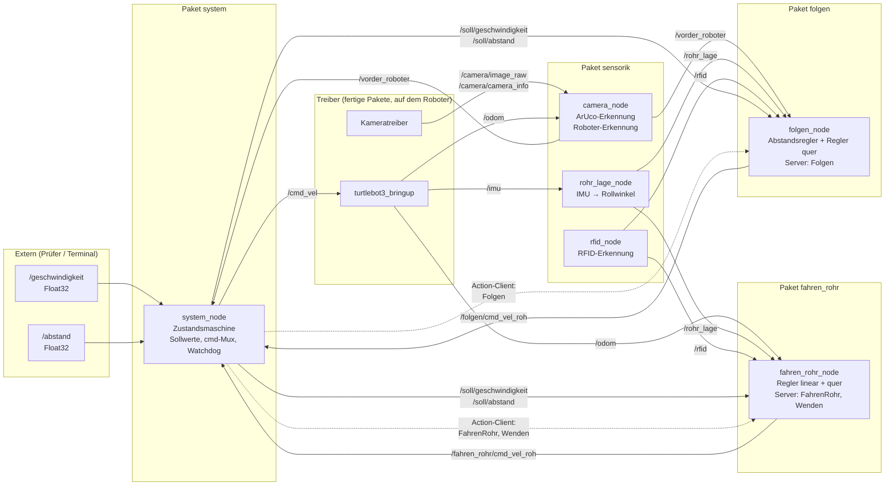
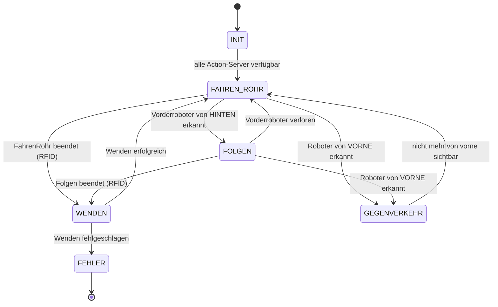

# Software-Architektur – TurtleBot3: Fahren im Rohr & Folgemanöver

> Stand: 12.11.2026. Plattform: TurtleBot3, ROS 2 Humble, Entwicklung im Docker-Devcontainer.
> Grundlage ist die Team-Skizze `Architektur.pdf` (system_node, fahren_im_rohr_node, folgen_node,
> camera_node, rfid_node). Kapitel 2 erklärt, wo und warum dieses Dokument von der Skizze abweicht.
>
> Das System besteht aus zwei Teilaufgaben, die am Ende zu **einem** System integriert werden:
> - **1.3.2 Fahren im Rohr** – auf dem Rohrgrund fahren, Abweichung ausregeln, an den Enden (RFID) wenden
> - **1.3.3 Folgemanöver** – Roboter per ArUco erkennen, Abstand berechnen, mit Soll-Abstand folgen

---

## 1. Anforderungen

Jede Anforderung bekommt eine ID. Damit lässt sich in Code, Tests und Pull Requests darauf verweisen
(z.B. Commit „R-FOLGE-6: Begrenzung Soll-Abstand“). Die Zuordnung zu den Komponenten steht in [Kapitel 8](#8-rückverfolgbarkeit-anforderung--komponente--test).

### 1.1 Fahren im Rohr (Aufgabe 1.3.2)

| ID | Anforderung |
|---|---|
| R-ROHR-1 | Der Roboter abonniert ein Topic **Geschwindigkeit** (`std_msgs/Float32`). Der zuletzt empfangene Wert wird gespeichert. |
| R-ROHR-2 | Im Rohr fährt der Roboter mit der zuletzt empfangenen Geschwindigkeit. Wurde noch keine empfangen, gilt **0 m/s**. |
| R-ROHR-3 | Soll-Geschwindigkeiten außerhalb von **[0, 0.2] m/s** werden auf dieses Intervall begrenzt. |
| R-ROHR-4 | Der Roboter fährt auf dem **Grund des Rohrs**. Eine erkannte Abweichung wird ausgeregelt. |
| R-ROHR-5 | Die Lage im Rohr kann mit der **Kamera und/oder dem Beschleunigungssensor** erkannt werden. |
| R-ROHR-6 | An den Enden des Rohres **wendet** der Roboter. |
| R-ROHR-7 | Die Wendeplattform kann über einen **RFID-Tag** erkannt werden. |

### 1.2 Folgemanöver (Aufgabe 1.3.3, baut auf 1.3.2 auf)

| ID | Anforderung |
|---|---|
| R-FOLGE-1 | Der Roboter erkennt **vorausfahrende oder stehende** Roboter. Bei stehenden Robotern wird erkannt, ob man sie **von hinten oder von vorne** sieht. Von vorne → **Fehlermeldung**. |
| R-FOLGE-2 | Der Roboter berechnet den **Abstand** zu einem vorausfahrenden oder stehenden Roboter. |
| R-FOLGE-3 | Erkennung und Abstand können über die **Kamera und ArUco-Marker** auf den Robotern erfolgen. |
| R-FOLGE-4 | Der Roboter abonniert ein Topic **Abstand** (`std_msgs/Float32`). Der zuletzt empfangene Wert wird gespeichert. |
| R-FOLGE-5 | Wird ein vorausfahrender Roboter erkannt, folgt der Roboter ihm mit dem zuletzt empfangenen Soll-Abstand. Wurde noch keiner empfangen, gilt **0.5 m**. |
| R-FOLGE-6 | Soll-Abstände außerhalb von **[0.2, 1.0] m** werden auf dieses Intervall begrenzt. |

### 1.3 Abgeleitete (eigene) Anforderungen

| ID | Anforderung |
|---|---|
| R-SYS-1 | Auch beim Folgen im Rohr wird **quer geregelt**, der Roboter bleibt also auf dem Rohrgrund. |
| R-SYS-2 | Ungültige Werte auf `Geschwindigkeit`/`Abstand` (NaN, ±inf) werden verworfen; der letzte gültige Wert bleibt erhalten. |
| R-SYS-3 | Kommt längere Zeit (~0.5 s) kein Fahrbefehl vom aktiven Knoten, bleibt der Roboter stehen (Watchdog). |
| R-SYS-4 | Wird ein Roboter von vorne gesehen, hält der eigene Roboter zusätzlich zur Fehlermeldung an (Kollisionsgefahr im Rohr). |
| R-SYS-5 | Nach dem Wenden wird derselbe RFID-Tag ignoriert, bis der Roboter die Plattform verlassen hat. Sonst wendet er sofort erneut. |

---

## 2. Abgleich mit der Skizze

Die Grundstruktur der Skizze bleibt: eine Zustandsmaschine im `system_node` als einziger Publisher
auf `cmd_vel`, je ein Knoten für *Fahren im Rohr* und *Folgen*, die Sensorik in eigenen Knoten
und die Actions `wenden`, `fahren_rohr` und `folgen`. Folgende Punkte sind gegenüber der Skizze geändert:

| # | Skizze | Hier | Begründung |
|---|---|---|---|
| 1 | Msgs `Geschwindigkeit` und `Abstand` im `interface_package` | **`std_msgs/Float32`**, keine eigenen Msgs | Die Aufgabe schreibt den Typ Float32 Message vor (R-ROHR-1, R-FOLGE-4). Mit einer eigenen Msg kann der Prüfer nicht publizieren. |
| 2 | `system_node` abonniert Geschwindigkeit/Abstand, aber wie die Werte zu den Reglern kommen, ist offen | `system_node` prüft und begrenzt die Werte und gibt sie intern auf `/soll/geschwindigkeit` und `/soll/abstand` weiter | Begrenzung und Default-Werte gibt es dann nur an **einer** Stelle. Mit QoS *transient local* bekommen auch spät gestartete Knoten sofort den aktuellen Wert. |
| 3 | `camera_node` berechnet auch die `RohrLage` | eigener Knoten **`rohr_lage_node`** auf Basis der **IMU** (`/imu`) | Die Rohrlage kommt vom Beschleunigungssensor, nicht von der Kamera. Ein eigener Knoten läuft im IMU-Takt und bleibt nicht hängen, wenn die Bildverarbeitung langsam ist. Die Kamera kann später zusätzlich einfließen. |
| 4 | `fahren_im_rohr_node` und `folgen_node` abonnieren `ArUco` | nur `folgen_node` (bzw. `system_node`) bekommt **`VorderRoboter`**, die rohen Marker nicht | Die Regler brauchen nur „Roboter ja/nein, Abstand, Seite“. Die Marker-Auswertung bleibt in der Sensorik, so gibt es weniger Abhängigkeiten. |
| 5 | `folgen_node` abonniert `RohrLage`, Querregelung dort offen | `folgen_node` nutzt **dieselbe Querregler-Klasse** wie `fahren_rohr` (Import aus Paket `fahren_rohr`) | Beim Folgen im Rohr muss genauso auf dem Grund gefahren werden (R-SYS-1), aber der Regler soll nicht doppelt programmiert werden. |
| 6 | Paket `hardware` | Paket **`sensorik`** | Es enthält Auswertung (ArUco, Roboter, Rohrlage, RFID), keine Treiber. Die Treiber kommen von `turtlebot3_bringup` und dem Kameratreiber. |
| 7 | `folgen_rohr_node` (Paketliste) vs. `folgen_node` (Diagramm) | einheitlich **`folgen_node`** | Einheitliche Namen |
| 8 | Gestrichelte Linie `folgen` → `wenden_action` | Wenden ruft **nur der `system_node`** auf | Nach Fahren *und* nach Folgen wird gleich gewendet. Die Entscheidung dafür trifft die Zustandsmaschine. |
| 9 | Msg-Namen `rohr_lage`, `aruco_marker`, … | **`RohrLage.msg`, `ArucoMarker.msg`, …** | ROS 2 verlangt CamelCase für Msg- und Action-Dateien, sonst bricht `colcon build` ab. |

---

## 3. Überblick

### Knoten-Graph



### Rollen der Knoten

| Knoten | Paket | Rolle |
|---|---|---|
| `system_node` | `system` | **Chef:** Zustandsmaschine, Sollwerte, entscheidet, welcher Regler fahren darf, einziger Publisher auf `/cmd_vel` |
| `fahren_rohr_node` | `fahren_rohr` | Fährt im Rohr mit Soll-Geschwindigkeit auf dem Rohrgrund; wendet |
| `folgen_node` | `folgen` | Folgt einem Vorderroboter mit Soll-Abstand, ebenfalls auf dem Rohrgrund |
| `camera_node` | `sensorik` | Bild → ArUco-Marker → `VorderRoboter` (Abstand, vorne/hinten, steht/fährt) |
| `rohr_lage_node` | `sensorik` | IMU → Rollwinkel im Rohr |
| `rfid_node` | `sensorik` | RFID-Leser → Tag-UID, Wendeplattform ja/nein |

**Grundregeln:**
1. Nur der `system_node` publiziert auf `/cmd_vel`. Die Regler publizieren auf eigene
   `.../cmd_vel_roh`-Topics („cmd roh“ in der Skizze). Der `system_node` leitet nur das Topic
   des Knotens weiter, der im aktuellen Zustand aktiv ist (Multiplexer).
2. **Wann** etwas passiert, entscheidet der `system_node`. **Wie** gefahren wird, entscheiden die Regler-Knoten.
3. Jeder Knoten besteht aus einer **ROS-Hülle (`*_node.py`) und reiner Logik (`*_logik.py`) ohne ROS**,
   wie in der Skizze vorgesehen. Die Logik ist damit mit `pytest` ohne Roboter testbar.

---

## 4. Pakete und Ordnerstruktur

```
ros2_turtlebot_project/
├── Dockerfile
├── .devcontainer/
├── docs/ARCHITEKTUR.md
└── src/
    ├── interface_package/        # ament_cmake (existiert schon, GoTo.action später entfernen)
    │   ├── msg/
    │   │   ├── RohrLage.msg
    │   │   ├── ArucoMarker.msg
    │   │   ├── ArucoMarkerArray.msg
    │   │   ├── VorderRoboter.msg
    │   │   └── Rfid.msg
    │   └── action/
    │       ├── Wenden.action
    │       ├── FahrenRohr.action
    │       └── Folgen.action
    │
    ├── sensorik/                 # ament_python   (Skizze: „hardware“)
    │   └── sensorik/
    │       ├── camera_node.py
    │       ├── aruco_erkennung.py        # reine Logik (OpenCV)
    │       ├── roboter_erkennung.py      # reine Logik (ID → Seite, Abstand, steht/fährt)
    │       ├── rohr_lage_node.py
    │       ├── rohr_lage.py              # reine Logik (Rollwinkel, Filter, Offset)
    │       ├── rfid_node.py
    │       └── rfid_erkennung.py         # reine Logik (UID-Liste, Entprellen)
    │
    ├── fahren_rohr/              # ament_python
    │   └── fahren_rohr/
    │       ├── fahren_rohr_node.py       # Action-Server FahrenRohr + Wenden
    │       ├── fahren_rohr_logik.py
    │       ├── regler_linear.py          # Geschwindigkeit mit Rampe
    │       ├── regler_quer.py            # PD auf Rollwinkel – wird auch von folgen genutzt
    │       └── wenden_logik.py           # Drehung um 180° (kann Bahnberechnung nutzen)
    │
    ├── folgen/                   # ament_python, <depend>fahren_rohr</depend>
    │   └── folgen/
    │       ├── folgen_node.py            # Action-Server Folgen
    │       └── folgen_logik.py           # Abstandsregler; importiert fahren_rohr.regler_quer
    │
    ├── system/                   # ament_python
    │   └── system/
    │       ├── system_node.py            # Action-Clients, Mux, Watchdog
    │       ├── system_logik.py           # Zustandsmaschine (reine Logik)
    │       └── sollwerte.py              # Begrenzung + Defaults (R-ROHR-3, R-FOLGE-6)
    │
    └── bringup/                  # ament_python (nur Daten)
        ├── launch/
        │   ├── roboter.launch.py         # auf dem TurtleBot: bringup, Kamera, rfid_node
        │   └── laptop.launch.py          # im Container: alles andere
        └── config/
            ├── regler.yaml               # Verstärkungen, Rampen, ω_max
            ├── aruco.yaml                # Dictionary, Markergröße, ID → (Roboter, Seite)
            ├── rfid.yaml                 # UIDs der Wendeplattformen
            └── camera_calibration.yaml
```

Hinweis zum Paketnamen `system`: Er ist sehr allgemein. Bei Namenskonflikten (z.B. mit einem
Python-Modul) in `rohr_system` umbenennen.

---

## 5. Schnittstellen (`interface_package`)

Diese Schnittstellen sollten **als Erstes** gemeinsam festgelegt und gemergt werden.
Danach kann jeder an seinem Paket arbeiten.

### 5.1 Vorgegebene Topics (aus der Aufgabe)

| Topic | Typ | Default | Begrenzung | Abonniert von |
|---|---|---|---|---|
| `/geschwindigkeit` | `std_msgs/Float32` | 0.0 m/s | [0, 0.2] | `system_node` |
| `/abstand` | `std_msgs/Float32` | 0.5 m | [0.2, 1.0] | `system_node` |

Die genauen Topic-Namen (Groß-/Kleinschreibung, Namespace) beim Betreuer erfragen. Im Code nicht
fest verdrahten, sondern per Remapping in der Launch-Datei anpassbar halten. Test von Hand:
```bash
ros2 topic pub --once /geschwindigkeit std_msgs/msg/Float32 "{data: 0.15}"
```

### 5.2 Messages

```text
# RohrLage.msg
std_msgs/Header header
float32 rollwinkel        # phi [rad], 0 = auf dem Rohrgrund
float32 rollrate          # dphi/dt [rad/s]
bool    gueltig

# ArucoMarker.msg
int32 id
geometry_msgs/Pose pose   # Pose des Markers im Kamera-Frame

# ArucoMarkerArray.msg    (nur intern/Debug im camera_node)
std_msgs/Header header
ArucoMarker[] markers

# VorderRoboter.msg
std_msgs/Header header
uint8 SEITE_HINTEN=0
uint8 SEITE_VORNE=1
bool    erkannt
int32   marker_id
uint8   seite             # HINTEN = wir sehen sein Heck, VORNE = seine Front
float32 abstand           # [m]
bool    steht
float32 geschwindigkeit   # geschätzte Geschwindigkeit des anderen [m/s]

# Rfid.msg
std_msgs/Header header
string uid
bool   wendeplattform     # UID steht in rfid.yaml als Wendeplattform
```

### 5.3 Actions

Alle Actions laufen, bis ihr Ziel erreicht ist oder der `system_node` sie abbricht.

```text
# FahrenRohr.action – fahre bis zum Rohrende (Wendeplattform)
---
uint8 GRUND_RFID=0
uint8 GRUND_ABGEBROCHEN=1
uint8 grund
bool  success
---
float32 v_ist
float32 rollwinkel
float32 gefahrene_strecke

# Folgen.action – folge dem Vorderroboter bis zum Rohrende
---
uint8 GRUND_RFID=0
uint8 GRUND_ABGEBROCHEN=1
uint8 grund
bool  success
---
float32 abstand_ist
float32 abstand_soll
float32 v_ist

# Wenden.action
float32 winkel            # [rad], Standard pi
---
bool success
---
float32 restwinkel
```

Wie in der Skizze abonnieren `fahren_rohr_node` und `folgen_node` den RFID-Tag selbst: Erreichen
sie eine Wendeplattform, beenden sie ihre Action mit `GRUND_RFID`. Die Action hat damit ein
natürliches Ende („fahre bis zum Rohrende“), und der `system_node` startet danach das Wenden.
Den Tag, auf dem der Roboter beim Start der Action steht, ignorieren beide Knoten (R-SYS-5).

### 5.4 Topics (Übersicht)

| Topic | Typ | Publisher | Subscriber |
|---|---|---|---|
| `/geschwindigkeit`, `/abstand` | `std_msgs/Float32` | extern | system_node |
| `/soll/geschwindigkeit`, `/soll/abstand` | `std_msgs/Float32` (transient local) | system_node | fahren_rohr_node, folgen_node |
| `/imu` | `sensor_msgs/Imu` | turtlebot3_bringup | rohr_lage_node |
| `/odom` | `nav_msgs/Odometry` | turtlebot3_bringup | camera_node, fahren_rohr_node |
| `/camera/image_raw` (bzw. `/compressed`), `/camera/camera_info` | `sensor_msgs/...` | Kameratreiber | camera_node |
| `/rohr_lage` | `interface_package/RohrLage` | rohr_lage_node | fahren_rohr_node, folgen_node |
| `/vorder_roboter` | `interface_package/VorderRoboter` | camera_node | system_node, folgen_node |
| `/rfid` | `interface_package/Rfid` | rfid_node | fahren_rohr_node, folgen_node |
| `/aruco/debug_image` | `sensor_msgs/Image` | camera_node | rqt (Debug) |
| `/fahren_rohr/cmd_vel_roh` | `geometry_msgs/Twist` | fahren_rohr_node | system_node |
| `/folgen/cmd_vel_roh` | `geometry_msgs/Twist` | folgen_node | system_node |
| `/cmd_vel` | `geometry_msgs/Twist` | system_node | turtlebot3_bringup |
| `/system/zustand`, `/system/fehler` | `std_msgs/String` | system_node | Konsole / Debug |

---

## 6. Komponenten im Detail

### 6.1 `system_node` – Zustandsmaschine, Sollwerte, cmd-Mux

**Sollwerte (`sollwerte.py`), R-ROHR-1…3, R-FOLGE-4…6, R-SYS-2:**
```python
v_soll = 0.0          # R-ROHR-2: Default
d_soll = 0.5          # R-FOLGE-5: Default

def neue_geschwindigkeit(wert):          # R-ROHR-1
    if math.isfinite(wert):              # R-SYS-2
        v_soll = clamp(wert, 0.0, 0.2)   # R-ROHR-3

def neuer_abstand(wert):                 # R-FOLGE-4
    if math.isfinite(wert):
        d_soll = clamp(wert, 0.2, 1.0)   # R-FOLGE-6
```
Die Defaults werden beim Start einmal auf `/soll/...` publiziert, danach bei jeder Änderung.

**Zustandsmaschine (`system_logik.py`):**



| Zustand | aktive Action | Mux leitet weiter | Bemerkung |
|---|---|---|---|
| INIT | – | nichts (Stopp) | wartet auf Action-Server (`wait_for_server`) |
| FAHREN_ROHR | `FahrenRohr` | `/fahren_rohr/cmd_vel_roh` | |
| FOLGEN | `Folgen` | `/folgen/cmd_vel_roh` | Wechsel: `FahrenRohr` abbrechen, dann `Folgen` starten |
| WENDEN | `Wenden` | `/fahren_rohr/cmd_vel_roh` | |
| GEGENVERKEHR | – | nichts (Stopp) | Fehlermeldung über `get_logger().error()` und `/system/fehler` (R-FOLGE-1, R-SYS-4) |
| FEHLER | – | nichts (Stopp) | |

- **Hysterese:** Der Vorderroboter muss z.B. 5 Bilder in Folge erkannt bzw. verloren sein, bevor
  der Zustand wechselt. Sonst springt das System bei Fehlerkennungen hin und her.
- Action-Clients **asynchron** aufrufen (`send_goal_async`, `cancel_goal_async` + Callbacks)
  und in Callbacks nie blockierend warten.
- **Mux + Watchdog (R-SYS-3):** Kommt vom aktiven Topic länger als 0.5 s nichts, wird ein
  Stopp-Befehl gesendet. Zusätzlich v auf [0, 0.2] und ω auf ±ω_max begrenzen.

### 6.2 `fahren_rohr_node` – Fahren im Rohr und Wenden

Zwei Action-Server in einem Knoten, deshalb `MultiThreadedExecutor` + Callback-Groups verwenden
(wie im bisherigen `SimpleMoverServer`).

**Regler linear (`regler_linear.py`):** fährt `v_soll` mit einer **Rampe** an
(z.B. 0.2 m/s²). Bei einem Sprung der Geschwindigkeit würde der Roboter sonst ruckeln und die Wand
hochrutschen.

**Regler quer (`regler_quer.py`), R-ROHR-4:** PD-Regler auf den Rollwinkel
```
ω = −K_p · φ − K_d · φ̇        (begrenzt auf ±ω_max)
```
- Fährt der Roboter seitlich die Rohrwand hoch, kippt er um die Längsachse (φ ≠ 0).
- Der D-Anteil dämpft, weil ein schräg fahrender Roboter die Wand hochklettert
  (φ̇ ≈ v·sin(ψ)/R). Ohne D-Anteil schwingt der Roboter.
- **Vorzeichen** am echten Roboter prüfen.
- Bei v ≈ 0 ist ω = 0, denn im Stand kann ein Differentialantrieb die Querablage nicht korrigieren.

**Wenden (`wenden_logik.py`), R-ROHR-6:** auf der Stelle um π drehen, geregelt über den Gierwinkel
aus `/odom`. Dafür kann die bestehende `Bahnberechnung` wiederverwendet werden: Zielposition =
aktuelle Position und `ziel_theta = theta + π`. Dann wird nur Phase 2 (Drehen) ausgeführt.

### 6.3 `folgen_node` – Folgemanöver (R-FOLGE-5)

**Abstandsregler (`folgen_logik.py`):**
```
v = v_vorne + K_a · (d_ist − d_soll)
v = clamp(min(v, v_soll), 0, 0.2)        # nicht schneller als im Rohr erlaubt (siehe Kap. 10)
ω = regler_quer(φ, φ̇)                    # gleiche Klasse wie in fahren_rohr (R-SYS-1)
```
- `v_vorne` (geschätzte Geschwindigkeit des Vorderroboters aus `VorderRoboter`) wirkt als
  Vorsteuerung. Ohne sie bleibt ein Abstandsfehler bestehen.
- Ein stehender Roboter von hinten ist nur der Sonderfall `v_vorne = 0`: Der Roboter hält bei
  `d_soll` dahinter an.
- Ist der Vorderroboter kurz nicht sichtbar, mit der letzten Messung weiterrechnen bzw. langsamer
  werden. Den Wechsel zurück zu `FahrenRohr` entscheidet der `system_node`.

### 6.4 `camera_node` – ArUco- und Roboter-Erkennung (R-FOLGE-1…3)

- Bild + `camera_info` → `cv_bridge` → `cv2.aruco` → Pose je Marker
  (`estimatePoseSingleMarkers` / `solvePnP`).
- **Vorne/hinten über die Marker-ID:** Beide Marker zeigen zur Kamera, deshalb lässt sich die Seite
  nur über die ID unterscheiden. Die Zuordnung steht in `aruco.yaml`:
  ```yaml
  roboter_marker:
    10: {roboter: tb3_a, seite: hinten}
    11: {roboter: tb3_a, seite: vorne}
  ```
- **Abstand:** Tiefe (z) des Markers im Kamera-Frame, korrigiert um die Versätze zur eigenen Front und
  zum Heck des anderen Roboters.
- **Steht/fährt:** Geschwindigkeit des anderen = eigene Geschwindigkeit (`/odom`) + Änderung des
  Abstands über die Zeit (gefiltert). Liegt sie unter einem Schwellwert, gilt er als stehend.
- Mehrere Roboter sichtbar → den nächsten verwenden. Debug-Bild mit eingezeichneten Markern publizieren.
- **Voraussetzung:** Kamera kalibrieren (`ros2 run camera_calibration cameracalibrator ...`).
- **OpenCV in Humble ist 4.5.4**, also gilt die *alte* ArUco-API (`cv2.aruco.Dictionary_get`,
  `DetectorParameters_create`, `detectMarkers`). Tutorials mit `cv2.aruco.ArucoDetector` (≥ 4.7)
  funktionieren nicht. Kein `opencv-contrib-python` per pip nachinstallieren.

### 6.5 `rohr_lage_node` – Lage im Rohr (R-ROHR-5)

- Quelle: `/imu` vom OpenCR-Board.
- Rollwinkel aus der Beschleunigung: `φ_acc = atan2(a_y, a_z)`, verrauscht beim Fahren, deshalb
  **Komplementärfilter** mit dem Gyroskop: `φ = α·(φ + ω_x·Δt) + (1−α)·φ_acc`, mit α ≈ 0.95–0.98.
- **Nullpunkt kalibrieren:** im Stand auf ebenem Boden den Mittelwert als Offset speichern.
- Kamera-basierte Rohrerkennung (in der Skizze im `camera_node`) ist eine optionale Ausbaustufe und
  kann später hier mit einfließen.

### 6.6 `rfid_node` (R-ROHR-7)

- Läuft auf dem Roboter und liest den RFID-Leser aus (Hardware im Labor klären, z.B. RC522 über
  SPI oder ein USB-Leser).
- Publiziert jede erkannte UID mit dem Flag `wendeplattform` (Abgleich mit `rfid.yaml`).
- Entprellen: Derselbe Tag wird nur einmal gemeldet, solange er ununterbrochen gelesen wird.

---

## 7. Verteilung und Netzwerk

| Auf dem Roboter (RPi) | Im Container auf dem Laptop |
|---|---|
| `turtlebot3_bringup`, Kameratreiber, `rfid_node` | `camera_node`, `rohr_lage_node`, `fahren_rohr_node`, `folgen_node`, `system_node`, rqt/RViz |

- **Eigene `ROS_DOMAIN_ID` pro Team** (in `devcontainer.json` → `containerEnv` und auf dem Roboter
  in `~/.bashrc`). Beim Folgemanöver fahren mehrere TurtleBots gleichzeitig, mit gleicher ID würde
  euer Roboter das `/cmd_vel` eines anderen Teams ausführen. Die Roboter erkennen sich nur optisch,
  sie müssen nicht miteinander kommunizieren.
- Kamerabilder komprimiert übertragen (`ros-humble-image-transport-plugins`). Wird das WLAN zum
  Problem, `camera_node` auf den Roboter verlegen. Dafür ändert sich nur die Launch-Datei.
- Das gilt genauso für `rohr_lage_node` und die Regler, falls die Latenz über WLAN stört.

---

## 8. Rückverfolgbarkeit: Anforderung → Komponente → Test

| Anforderung | Komponente | Nachweis |
|---|---|---|
| R-ROHR-1 | `system_node` | `ros2 topic pub /geschwindigkeit ...` → `/soll/geschwindigkeit` ändert sich |
| R-ROHR-2 | `sollwerte.py`, `regler_linear.py` | Unit-Test: ohne Nachricht → v = 0 |
| R-ROHR-3 | `sollwerte.py` | Unit-Test: −1 → 0, 0.1 → 0.1, 5 → 0.2, NaN → ignoriert |
| R-ROHR-4 | `regler_quer.py`, `rohr_lage_node` | Unit-Test Regler; Fahrversuch mit seitlichem Start im Rohr |
| R-ROHR-5 | `rohr_lage_node` | Roboter von Hand kippen → φ plausibel |
| R-ROHR-6 | `fahren_rohr_node` (Wenden), `system_logik.py` | Fahrversuch: 180° drehen, zurück ins Rohr |
| R-ROHR-7 | `rfid_node`, `FahrenRohr`/`Folgen` | Tag an den Leser halten → `/rfid`, Action endet mit `GRUND_RFID` |
| R-FOLGE-1 | `roboter_erkennung.py`, `system_logik.py` | Unit-Test ID → Seite; Versuch: Roboter von vorne → Fehlermeldung |
| R-FOLGE-2 | `roboter_erkennung.py` | Marker in bekanntem Abstand (Maßband) messen |
| R-FOLGE-3 | `aruco_erkennung.py` | Debug-Bild zeigt Marker mit ID und Achsen |
| R-FOLGE-4 | `system_node` | `ros2 topic pub /abstand ...` |
| R-FOLGE-5 | `folgen_logik.py`, `sollwerte.py` | Unit-Test Default 0.5; Versuch: Abstand zu fahrendem Roboter hält sich |
| R-FOLGE-6 | `sollwerte.py` | Unit-Test: 0.1 → 0.2, 0.7 → 0.7, 3 → 1.0 |
| R-SYS-1…5 | siehe Kap. 6 | Unit-Tests `system_logik.py` (Zustandsübergänge), Versuche |

---

## 9. Team, Meilensteine, Zusammenarbeit

### Aufteilung (Vorschlag, entlang der Pakete)

| Person | Pakete |
|---|---|
| A | `fahren_rohr` + `rohr_lage_node` (Teil 1.3.2: IMU, Regler quer/linear, Wenden) |
| B | `folgen` + `camera_node` (Teil 1.3.3: Kamera, Kalibrierung, ArUco, Abstandsregler) |
| C | `system` + `rfid_node` + `bringup` (Zustandsmaschine, Sollwerte, Mux, Launch-Dateien, Integration) |

Gemeinsam zuerst: `interface_package` festlegen.

### Meilensteine

1. `interface_package` + leere Paketgerüste bauen mit `colcon build`; Unit-Tests für `sollwerte.py` sind grün
2. `rohr_lage_node` liefert plausiblen Rollwinkel; `FahrenRohr` fährt mit `/geschwindigkeit` und regelt quer aus
3. RFID erkannt, Wenden funktioniert, `system_node` pendelt zwischen den Rohrenden (**1.3.2 komplett**)
4. `camera_node`: Abstand und vorne/hinten stimmen (**1.3.3 Wahrnehmung**)
5. `Folgen` mit `/abstand`, Zustandswechsel FAHREN_ROHR ↔ FOLGEN, Gegenverkehr (**1.3.3 komplett**)
6. Gesamttest mit mehreren Robotern

### Zusammenarbeit im GitHub-Repo

- `main` schützen, auf Feature-Branches arbeiten (`feature/regler-quer`, …) und per Pull Request
  mit Review durch eine zweite Person mergen.
- In Commits und PRs die Anforderungs-ID nennen (`R-ROHR-3: ...`).
- Änderungen am `interface_package` immer kurz absprechen, sie betreffen alle.
- `.gitignore` um `__pycache__/` und `*.pyc` ergänzen (aktuell sind `.pyc`-Dateien eingecheckt).
- Parameter (Verstärkungen, Marker-IDs, RFID-UIDs) nur in YAML-Dateien ablegen, nicht im Code.

---

## 10. Offene Punkte / mit dem Betreuer klären

- **Topic-Namen:** genau `Geschwindigkeit` / `Abstand` (Großschreibung?), mit oder ohne Namespace?
- **Hardware:** TurtleBot3-Modell (der Burger hat ab Werk keine Kamera), welche Kamera mit welchem
  Treiber, welcher RFID-Leser und wie ist er angeschlossen?
- **Rohr:** Durchmesser, Länge. Passt der Roboter hinein? Ist es im Rohr hell genug für die Marker?
- **Wendeplattform:** eben und außerhalb des Rohrs? Eigene UID pro Ende?
- **ArUco:** Dictionary, Markergröße, IDs. Sind Marker vorne *und* hinten angebracht?
- **Abstand:** zwischen welchen Punkten wird gemessen (Kamera–Marker oder Roboter–Roboter)?
- **Folgen vs. Soll-Geschwindigkeit:** Darf der Roboter beim Folgen schneller als `/geschwindigkeit`
  fahren? Hier angenommen: nein, es gilt `min(v_soll, v_folge)`.
- **Gegenverkehr:** Reicht eine Fehlermeldung, oder soll der Roboter auch anhalten oder wenden?
  Gilt das auch für einen *fahrenden* Roboter, der von vorne kommt?
