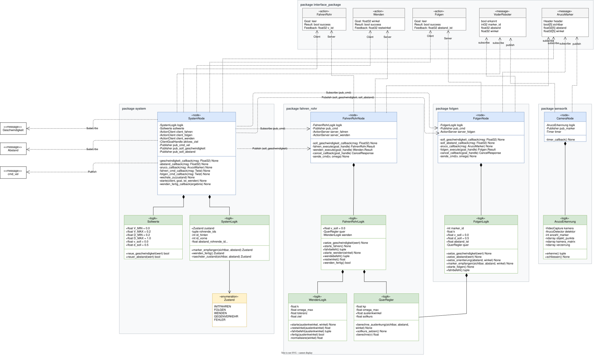
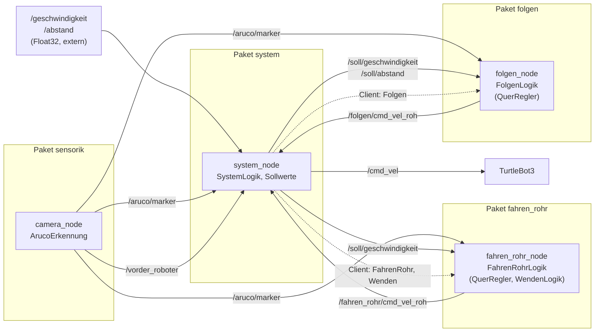
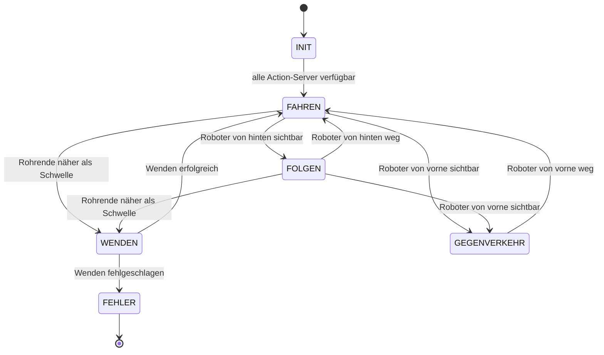

# Architektur Markdown wurde von KI erstellt und bildet momentan keine korrekte Architektur des Gesamten Systems dar!!
# Dient nur zur Orientierung


----------------------------------------------------------------------------------------------------------------------

# Software-Architektur – TurtleBot3: Fahren im Rohr & Folgemanöver

> Stand: 19.11.2026, abgeglichen mit [`docs/uml/klassendiagramm_v4.drawio.svg`](uml/klassendiagramm_v4.drawio.svg)
> (Commit „Klassendiagramm überarbeitet“) und den Dateien in `src/interface_package`.
> Wo Diagramm und Code sich widersprechen, steht das in [Kapitel 7](#7-abweichungen-und-offene-punkte).



## 1. Anforderungen
### 1.1 Fahren im Rohr (Aufgabe 1.3.2)

| ID | Anforderung |
|---|---|
| R-ROHR-1 | Der Roboter abonniert ein Topic **Geschwindigkeit** (`std_msgs/Float32`). Der zuletzt empfangene Wert wird gespeichert. |
| R-ROHR-2 | Im Rohr fährt der Roboter mit der zuletzt empfangenen Geschwindigkeit. Wurde noch keine empfangen, gilt **0 m/s**. |
| R-ROHR-3 | Soll-Geschwindigkeiten außerhalb von **[0, 0.2] m/s** werden auf dieses Intervall begrenzt. |
| R-ROHR-4 | Der Roboter fährt auf dem **Grund des Rohrs**. Eine erkannte Abweichung wird ausgeregelt. |
| R-ROHR-5 | Die Lage im Rohr kann mit der **Kamera und/oder dem Beschleunigungssensor** erkannt werden. → Umsetzung über die **Kamera**: Winkel zum ArUco-Marker (`QuerRegler`). |
| R-ROHR-6 | An den Enden des Rohres **wendet** der Roboter. |
| R-ROHR-7 | Die Wendeplattform kann über einen **RFID-Tag** erkannt werden. → **Entfällt vorerst** (Absprache Team/Prof, RFID zu ungenau). Das Rohrende wird stattdessen über einen **ArUco-Marker** erkannt. |

### 1.2 Folgemanöver (Aufgabe 1.3.3, baut auf 1.3.2 auf)

| ID | Anforderung |
|---|---|
| R-FOLGE-1 | Der Roboter erkennt **vorausfahrende oder stehende** Roboter. Bei stehenden Robotern wird erkannt, ob man sie **von hinten oder von vorne** sieht. Von vorne → **Fehlermeldung**. |
| R-FOLGE-2 | Der Roboter berechnet den **Abstand** zu einem vorausfahrenden oder stehenden Roboter. |
| R-FOLGE-3 | Erkennung und Abstand können über die **Kamera und ArUco-Marker** auf den Robotern erfolgen. |
| R-FOLGE-4 | Der Roboter abonniert ein Topic **Abstand** (`std_msgs/Float32`). Der zuletzt empfangene Wert wird gespeichert. |
| R-FOLGE-5 | Wird ein vorausfahrender Roboter erkannt, folgt der Roboter ihm mit dem zuletzt empfangenen Soll-Abstand. Wurde noch keiner empfangen, gilt **0.5 m**. |
| R-FOLGE-6 | Soll-Abstände außerhalb von **[0.2, 1.0] m** werden auf dieses Intervall begrenzt. |

### 1.3 Abgeleitete (eigene) Anforderungen

| ID | Anforderung |
|---|---|
| R-SYS-1 | Auch beim Folgen wird **quer geregelt**: `FolgenLogik` nutzt denselben `QuerRegler` wie `FahrenRohrLogik`. |
| R-SYS-2 | Ungültige Werte auf `Geschwindigkeit`/`Abstand` (NaN, ±inf) werden verworfen; der letzte gültige Wert bleibt erhalten. |
| R-SYS-3 | ~~Watchdog: Kommt ~0.5 s kein Fahrbefehl, bleibt der Roboter stehen.~~ **Im Klassendiagramm v4 nicht mehr enthalten**, siehe Kap. 7. |
| R-SYS-4 | Wird ein Roboter von vorne gesehen, hält der eigene Roboter zusätzlich zur Fehlermeldung an (Kollisionsgefahr im Rohr). |
| R-SYS-5 | Ein Rohrende-Marker löst das Wenden erst unterhalb eines Schwellabstands aus (`abstand_rohrende_id`, z.B. 0.3 m). So löst der Marker am anderen Rohrende nicht schon aus der Ferne ein Wenden aus. |

---

## 2. Entscheidungen gegenüber der ersten Skizze

Die Grundstruktur der Team-Skizze (`Architektur.pdf`) bleibt: eine Zustandsmaschine im `system_node` als
einziger Publisher auf `cmd_vel`, je ein Knoten für *Fahren im Rohr* und *Folgen*, die Kamera in einem
eigenen Knoten und die Actions `Wenden`, `FahrenRohr` und `Folgen`.

| # | Skizze | Jetzt (Klassendiagramm v4) | Begründung |
|---|---|---|---|
| 1 | Msgs `Geschwindigkeit` und `Abstand` im `interface_package` | **`std_msgs/Float32`**, keine eigenen Msgs | Die Aufgabe schreibt den Typ Float32 vor (R-ROHR-1, R-FOLGE-4). |
| 2 | `system_node` abonniert Geschwindigkeit/Abstand | `system_node` prüft die Werte mit `Sollwerte` und verteilt sie auf `/soll/geschwindigkeit` und `/soll/abstand` | Prüfung, Begrenzung und Defaults gibt es nur an **einer** Stelle. |
| 3 | `RohrLage` aus dem `camera_node` | **keine `RohrLage`**, kein Rollwinkel, keine IMU | Der Roboter kann nicht an der Rohrwand hochfahren. Die Querregelung läuft über den **Winkel zum ArUco-Marker**. |
| 4 | Regler abonnieren `ArUco` | `camera_node` publiziert `ArucoMarker` (alle Marker) und `VorderRoboter` | Rohrende und Querregelung brauchen die Marker, das Folgen den Vorderroboter. |
| 5 | Querregelung in `folgen` offen | `FolgenLogik` nutzt den **`QuerRegler` aus `fahren_rohr`** | Der Regler wird nicht doppelt programmiert (R-SYS-1). |
| 6 | Paket `hardware` | Paket **`sensorik`** | Es enthält Auswertung (ArUco), keine Treiber. |
| 7 | Wenden aus `folgen` heraus | Wenden ruft **nur der `system_node`** auf | Die Entscheidung trifft die Zustandsmaschine. |
| 8 | RFID beendet die Fahrt | **kein RFID**, das Rohrende erkennt der `system_node` über einen ArUco-Marker | Absprache Team/Prof. |

---

## 3. Überblick

### Knoten-Graph



### Rollen der Knoten

| Knoten | Paket | Logik-Klassen | Rolle |
|---|---|---|---|
| `system_node` | `system` | `SystemLogik`, `Sollwerte` | **Chef:** prüft und verteilt Sollwerte, Zustandsmaschine, Action-Client, einziger Publisher auf `/cmd_vel` |
| `fahren_rohr_node` | `fahren_rohr` | `FahrenRohrLogik` (→ `QuerRegler`, `WendenLogik`) | Action-Server `FahrenRohr` und `Wenden` |
| `folgen_node` | `folgen` | `FolgenLogik` (→ `QuerRegler`) | Action-Server `Folgen` |
| `camera_node` | `sensorik` | `ArucoErkennung` | Kamerabild → `ArucoMarker` und `VorderRoboter` |

### Grundregeln

1. **Knoten = nur ROS-Schnittstelle.** Ein `*_node.py` liest Msgs, ruft seine Logik auf, publiziert das Ergebnis
   und verwaltet die Actions. Er rechnet und entscheidet nichts.
2. **Logik = ohne ROS.** Die Logik-Klassen importieren weder `rclpy` noch Msg-Typen und sind mit `pytest`
   ohne Roboter testbar. ROS-Konstanten (z.B. Marker-IDs) übergibt der Knoten im Konstruktor.
3. **Nur der `system_node` publiziert auf `/cmd_vel`.** Die Regler publizieren auf `.../cmd_vel_roh`, der
   `system_node` leitet nur den Befehl des Reglers weiter, der im aktuellen Zustand aktiv ist.
4. **Wann** etwas passiert, entscheidet der `system_node`. **Wie** gefahren wird, entscheiden die Regler-Knoten.

| Gehört in den Knoten | Gehört in die Logik |
|---|---|
| Publisher, Subscriber, Timer, Action-Server und -Clients | Rechnen, Entscheiden, Begrenzen |
| Msg-Felder auslesen und an die Logik übergeben | Sollwerte und Defaults speichern |
| Ergebnis der Logik in eine Msg schreiben und publizieren | Zustandsmaschine, Regler, Wenden |
| Action-Schleife, Feedback, Logger-Ausgaben | Kamera auslesen und Marker erkennen |

---

## 4. Pakete und Ordnerstruktur

```
ros2_turtlebot_project/
├── Dockerfile
├── .devcontainer/
├── docs/
│   ├── ARCHITEKTUR.md
│   └── uml/klassendiagramm_v4.drawio.svg
└── src/
    ├── interface_package/        # ament_cmake
    │   ├── msg/
    │   │   ├── ArucoMarker.msg
    │   │   └── VorderRoboter.msg
    │   └── action/
    │       ├── FahrenRohr.action
    │       ├── Folgen.action
    │       └── Wenden.action
    │
    ├── sensorik/                 # ament_python
    │   └── sensorik/
    │       ├── camera_node.py            # CameraNode (nur ROS)
    │       └── aruco_erkennung.py        # ArucoErkennung (Kamera + OpenCV)
    │
    ├── fahren_rohr/              # ament_python
    │   └── fahren_rohr/
    │       ├── fahren_rohr_node.py       # FahrenRohrNode (nur ROS), Server FahrenRohr + Wenden
    │       ├── fahren_rohr_logik.py      # FahrenRohrLogik
    │       ├── regler_quer.py            # QuerRegler, wird auch von folgen genutzt
    │       └── wenden_logik.py           # WendenLogik
    │
    ├── folgen/                   # ament_python, <depend>fahren_rohr</depend>
    │   └── folgen/
    │       ├── folgen_node.py            # FolgenNode (nur ROS), Server Folgen
    │       └── folgen_logik.py           # FolgenLogik, importiert fahren_rohr.regler_quer
    │
    └── system/                   # ament_python
        └── system/
            ├── system_node.py            # SystemNode (nur ROS), Clients
            ├── system_logik.py           # SystemLogik + Enum Zustand
            └── sollwerte.py              # Sollwerte
```

Nicht mehr im Modell und noch zu löschen: `sensorik/rohr_lage.py`, `sensorik/roboter_erkennung.py`,
`fahren_rohr/regler_linear.py`.

---

## 5. Schnittstellen

### 5.1 Vorgegebene Topics (aus der Aufgabe)

| Topic | Typ | Default | Begrenzung | Abonniert von |
|---|---|---|---|---|
| `/geschwindigkeit` | `std_msgs/Float32` | 0.0 m/s | [0, 0.2] | `system_node` |
| `/abstand` | `std_msgs/Float32` | 0.5 m | [0.2, 1.0] | `system_node` |

Die genauen Topic-Namen beim Betreuer erfragen und im Code per Remapping anpassbar halten.

### 5.2 Messages (`interface_package/msg`)

```text
# ArucoMarker.msg – Zustand aller bekannten Marker in einem Kamerabild
# Index im Array = Marker-ID. Laenge 5 ist vorlaeufig.
std_msgs/Header header
bool[5]    sichtbare_id      # im Klassendiagramm: sichtbar
float32[5] abstand           # [m], inf wenn nicht sichtbar
float32[5] winkel            # waagrechter Winkel zum Marker, Einheit festlegen (Kap. 7)

# VorderRoboter.msg – Ergebnis der Roboter-Erkennung
std_msgs/Header header
bool    erkannt
int32   marker_id
float32 abstand              # [m]
float32 winkel
```

**Regeln für `ArucoMarker`:**
1. **Index = Marker-ID.** Die Marker müssen IDs von 0 bis 4 haben. Fremde IDs werden ignoriert.
2. **Immer zuerst `sichtbare_id` prüfen.** Nicht sichtbare Marker haben `abstand = inf`, damit kein falsches
   „Rohrende nah“ entsteht.
3. **Jede ID hat nur einen Platz.** Tragen zwei Roboter denselben Marker, wird nur der nähere gemeldet.
4. **Ändert sich die Länge 5**, auf Laptop **und** Roboter alle Pakete neu bauen.

### 5.3 Actions (`interface_package/action`)

`FahrenRohr` und `Folgen` laufen, bis der `system_node` sie abbricht. `Wenden` endet von selbst.

```text
# FahrenRohr.action
---
bool success
---
float32 abstand              # im Klassendiagramm: v_ist

# Folgen.action
---
bool success
---
float32 abstand_ist

# Wenden.action
float32 winkel 3.14159265    # [rad], Default pi
---
bool success
---
float32 restwinkel
```

### 5.4 Topics (Übersicht)

| Topic | Typ | Publisher | Subscriber |
|---|---|---|---|
| `/geschwindigkeit`, `/abstand` | `std_msgs/Float32` | extern | `system_node` |
| `/soll/geschwindigkeit` | `std_msgs/Float32` (transient local) | `system_node` | `fahren_rohr_node`, `folgen_node` |
| `/soll/abstand` | `std_msgs/Float32` (transient local) | `system_node` | `folgen_node` |
| `/aruco/marker` | `interface_package/ArucoMarker` | `camera_node` | `system_node`, `fahren_rohr_node`, `folgen_node` |
| `/vorder_roboter` | `interface_package/VorderRoboter` | `camera_node` | `system_node` |
| `/fahren_rohr/cmd_vel_roh` | `geometry_msgs/Twist` | `fahren_rohr_node` | `system_node` |
| `/folgen/cmd_vel_roh` | `geometry_msgs/Twist` | `folgen_node` | `system_node` |
| `/cmd_vel` | `geometry_msgs/Twist` | `system_node` | `turtlebot3_bringup` |

### 5.5 Actions (Übersicht)

| Action | Server | Client | Ende |
|---|---|---|---|
| `FahrenRohr` | `fahren_rohr_node` | `system_node` | nur durch Abbruch |
| `Wenden` | `fahren_rohr_node` | `system_node` | von selbst (`succeed()`), Ergebnis über `wenden_fertig_callback` |
| `Folgen` | `folgen_node` | `system_node` | nur durch Abbruch |

---

## 6. Komponenten im Detail (nach Klassendiagramm v4)

> Dieser Abschnitt beschreibt den Stand des Klassendiagramms und ist noch vom Team zu prüfen.

### 6.1 Paket `system`

**`SystemNode`** (nur ROS)

| Attribute | Methoden |
|---|---|
| `logik: SystemLogik`, `sollwerte: Sollwerte` | `geschwindigkeit_callback(msg)`, `abstand_callback(msg)`: Wert an `Sollwerte` geben, bei Erfolg auf `/soll/…` publizieren |
| `client_fahren`, `client_folgen`, `client_wenden: ActionClient` | `aruco_callback(msg)`: Marker an `SystemLogik.marker_empfangen()`, bei neuem Zustand `wechsle_zu()` |
| `aktives_ziel: ClientGoalHandle` | `fahren_cmd_callback(msg)`, `folgen_cmd_callback(msg)`: Befehl des aktiven Reglers an `/cmd_vel` weiterleiten |
| `pub_cmd_vel`, `pub_soll_geschwindigkeit`, `pub_soll_abstand: Publisher` | `wechsle_zu(zustand)`: laufende Action abbrechen, passende Action starten bzw. bei GEGENVERKEHR anhalten und Fehler melden |
| | `starte(client, goal, ist_wenden)`: Goal asynchron senden, bei `Wenden` auf das Ergebnis warten |
| | `wenden_fertig_callback(ergebnis)`: Status prüfen, `SystemLogik.wenden_fertig()`, `wechsle_zu(FAHREN)` |

**`Sollwerte`** (Logik): `V_MIN = 0.0`, `V_MAX = 0.2`, `D_MIN = 0.2`, `D_MAX = 1.0` (statisch), `v_soll = 0.0`, `d_soll = 0.5`.
`neue_geschwindigkeit(wert)` und `neuer_abstand(wert)` verwerfen NaN/inf, begrenzen und geben `True` zurück,
wenn der Wert übernommen wurde (R-ROHR-1…3, R-FOLGE-4…6, R-SYS-2).

**`SystemLogik`** (Logik): `zustand`, `rohrende_ids`, `id_hinten`, `id_vorne`, `abstand_rohrende_id`.
`marker_empfangen(sichtbar, abstand)` gibt den neuen Zustand zurück oder `None`. `wenden_fertig()` setzt FAHREN.
`_naechster_zustand(sichtbar, abstand)` prüft die Regeln von oben nach unten:

| Priorität | Bedingung | neuer Zustand |
|---|---|---|
| 1 | gerade am Wenden | `WENDEN` (bleibt, bis das Wenden fertig ist) |
| 2 | Marker `id_vorne` sichtbar | `GEGENVERKEHR` (R-FOLGE-1, R-SYS-4) |
| 3 | Rohrende-Marker näher als `abstand_rohrende_id` | `WENDEN` (R-ROHR-6, R-SYS-5) |
| 4 | Marker `id_hinten` sichtbar | `FOLGEN` (R-FOLGE-5) |
| 5 | sonst | `FAHREN` |

**`Zustand`** (Enum): `INIT`, `FAHREN`, `FOLGEN`, `WENDEN`, `GEGENVERKEHR`, `FEHLER`



| Zustand | aktive Action | an `/cmd_vel` weitergeleitet |
|---|---|---|
| `INIT` | – | nichts (Stopp) |
| `FAHREN` | `FahrenRohr` | `/fahren_rohr/cmd_vel_roh` |
| `FOLGEN` | `Folgen` | `/folgen/cmd_vel_roh` |
| `WENDEN` | `Wenden` | `/fahren_rohr/cmd_vel_roh` |
| `GEGENVERKEHR` | – | nichts (Stopp), Fehlermeldung im Log |
| `FEHLER` | – | nichts (Stopp) |

### 6.2 Paket `fahren_rohr`

**`FahrenRohrNode`** (nur ROS): `logik: FahrenRohrLogik`, `pub_cmd`, `server_fahren`, `server_wenden`.
`soll_geschwindigkeit_callback(msg)` → `logik.setze_geschwindigkeit()`. `fahren_execute()` und `wenden_execute()`
rufen in einer Schleife (20 Hz) `logik.fahrbefehl()` bzw. `logik.wendebefehl()` auf und publizieren das Ergebnis.
`cancel_callback()` gibt `CancelResponse.ACCEPT` zurück.

**`FahrenRohrLogik`** (Logik), der einzige Ansprechpartner des Knotens:

| Methode | Aufgabe |
|---|---|
| `setze_geschwindigkeit(wert)` | `v_soll` übernehmen (schon geprüft vom `system_node`) |
| `starte_fahren()` | `quer.sollkurs_setzen()` |
| `fahrbefehl()` | `(v_soll, quer.berechne(v_soll))` |
| `starte_wenden(winkel)`, `wendebefehl()`, `restwinkel()`, `wenden_fertig()` | an `WendenLogik` weiterreichen |

**`QuerRegler`** (Logik, auch von `folgen` genutzt): `kp`, `omega_max`, `auslenkwinkel`, `sollkurs`.
- `berechne_auslenkung(sichtbar, abstand, winkel)`: berechnet aus den ArUco-Daten den `auslenkwinkel`,
  also wie weit der Roboter seitlich von der Richtung zum Marker abweicht (R-ROHR-4, R-ROHR-5 über die Kamera).
- `sollkurs_setzen()`: Sollwert für den Auslenkwinkel festlegen.
- `berechne(v)`: P-Regler `ω = kp · (sollkurs − auslenkwinkel)`, begrenzt auf ±`omega_max`. Bei `v ≈ 0` gilt `ω = 0`.

**`WendenLogik`** (Logik): `k`, `omega_max`, `toleranz`, `ziel`.
`starte(auslenkwinkel, winkel)`, `restwinkel(auslenkwinkel)`, `fahrbefehl(auslenkwinkel)` → `(0, ω)`,
`fertig(auslenkwinkel)`, `_normalisiere(winkel)` (statisch, bringt Winkel auf (−π, π]).

### 6.3 Paket `folgen`

**`FolgenNode`** (nur ROS): `logik: FolgenLogik`, `pub_cmd`, `server_folgen`.
`soll_geschwindigkeit_callback`, `soll_abstand_callback`, `aruco_callback` reichen die Werte an die Logik weiter.
`folgen_execute()` ruft in einer Schleife `logik.fahrbefehl()` auf und meldet `abstand_ist` als Feedback.

**`FolgenLogik`** (Logik): `marker_id`, `k`, `v_soll = 0.0`, `d_soll = 0.5`, `abstand_ist`, `quer: QuerRegler`.

| Methode | Aufgabe |
|---|---|
| `setze_geschwindigkeit(wert)`, `setze_abstand(wert)` | Sollwerte übernehmen |
| `marker_empfangen(sichtbar, abstand, winkel)` | Daten des Heck-Markers (`marker_id`) speichern (R-FOLGE-2) |
| `setze_orientierung(abstand, winkel)` | Daten an den `QuerRegler` geben |
| `starte_folgen()` | `quer.sollkurs_setzen()` |
| `fahrbefehl()` | `v = k · (abstand_ist − d_soll)`, begrenzt auf [0, `v_soll`]; `ω = quer.berechne(v)` (R-FOLGE-5) |

### 6.4 Paket `sensorik`

**`CameraNode`** (nur ROS): `logik: ArucoErkennung`, `pub_marker`, `timer`.
`timer_callback()` ruft `logik.erkenne()` auf, schreibt das Ergebnis in `ArucoMarker` bzw. `VorderRoboter` und publiziert.

**`ArucoErkennung`** (Logik): `kamera: VideoCapture`, `detektor: ArucoDetector`, `anzahl_marker`,
`objekt_punkte`, `kamera_matrix`, `verzerrung`.
- `erkenne()`: Bild lesen, Marker suchen (`DICT_5X5_100`), mit `solvePnP` Abstand und Winkel je Marker berechnen.
- `schliessen()`: Kamera freigeben.
- Die Testversion in `aruco_skripte/aruco_logic` unterstützt die alte (`Dictionary_get`) **und** die neue
  OpenCV-API (`ArucoDetector`).
- **Voraussetzung:** Kamera kalibrieren. Bisher stehen in `aruco_logic` eine geschätzte Brennweite und keine Verzerrung.

### 6.5 Technische Hinweise für alle Knoten mit Action-Server

- **`MultiThreadedExecutor` + `ReentrantCallbackGroup`:** Die `execute`-Schleifen laufen mit `time.sleep()`.
  Ohne mehrere Threads kommen währenddessen keine Topics und kein Cancel an.
- **`cancel_callback` muss `CancelResponse.ACCEPT` zurückgeben.** Der Standard in rclpy lehnt Abbrüche ab.
- **Soll-Topics mit `DurabilityPolicy.TRANSIENT_LOCAL`** auf beiden Seiten, damit spät gestartete Knoten den letzten Wert bekommen.
- **Client asynchron:** `send_goal_async`, `get_result_async`, `cancel_goal_async` mit `add_done_callback`,
  nie `spin_until_future_complete` in einem Callback.

---

## 7. Abweichungen und offene Punkte

### 7.1 Code passt nicht zum Diagramm

| # | Wo | Problem | Folge |
|---|---|---|---|
| 1 | `interface_package/CMakeLists.txt` | Dort steht noch `"msg/RohrLage.msg"`, die Datei ist aber gelöscht | **`colcon build` bricht ab.** Zeile entfernen. |
| 2 | `ArucoMarker.msg` | Feld heißt `sichtbare_id`, im Diagramm `sichtbar` | Einen Namen festlegen |
| 3 | `FahrenRohr.action` | Feedback ist `abstand`, im Diagramm `v_ist` | Einen Namen festlegen |
| 4 | `VorderRoboter.msg` | hat einen `header`, im Diagramm nicht | Diagramm ergänzen |
| 5 | `aruco_skripte/aruco_logic` | Marker-IDs 0 und **69** | Mit „Index = Marker-ID“ und Länge 5 passt ID 69 nicht. Entweder IDs 0–4 drucken oder eine Zuordnung ID → Index einführen. |
| 6 | `aruco_skripte/aruco_logic` | `winkel` in **Grad** | `QuerRegler` und `WendenLogik` rechnen mit rad. Eine Einheit festlegen, am besten rad. |

### 7.2 Lücken im Klassendiagramm

| # | Wo | Lücke | Vorschlag |
|---|---|---|---|
| 1 | `FahrenRohrNode` / `FahrenRohrLogik` | Der Knoten abonniert `/aruco/marker`, hat aber kein `aruco_callback`, und die Logik keine Methode, um die Marker an den `QuerRegler` zu geben | `aruco_callback` im Knoten und z.B. `FahrenRohrLogik.marker_empfangen(sichtbar, abstand, winkel)` ergänzen |
| 2 | `WendenLogik` | arbeitet mit `auslenkwinkel` aus der Kamera. Beim Drehen um 180° ist der Marker aber nicht im Bild, der Winkel lässt sich so nicht messen. | Gierwinkel aus `/imu` oder `/odom` nutzen, oder drehen, bis der Marker des **anderen** Rohrendes mittig im Bild ist |
| 3 | `QuerRegler` | Welcher Marker für `berechne_auslenkung` gilt, ist offen | Den Rohrende-Marker vor dem Roboter nehmen; ohne sichtbaren Marker `ω = 0` |
| 4 | `FolgenLogik` | `setze_orientierung(abstand, winkel)` und `marker_empfangen(...)` überschneiden sich | Eine Methode reicht: `marker_empfangen` gibt die Daten auch an den `QuerRegler` |
| 5 | `SystemLogik` | Watchdog (R-SYS-3) und die Mux-Regel `befehl_erlaubt()` sind entfallen | Ohne Watchdog fährt der Roboter bei einem Absturz eines Reglers mit dem letzten Befehl weiter. Die Mux-Entscheidung steht jetzt im Knoten, das widerspricht Grundregel 1. |
| 6 | `SystemLogik` | `INIT` und `FEHLER` sind im Enum, aber ohne Übergänge in den Methoden | `INIT → FAHREN` beim Start, `WENDEN → FEHLER` in `wenden_fertig_callback` |
| 7 | `SystemNode` / `VorderRoboter` | Wofür der `system_node` `/vorder_roboter` braucht, ist offen. Die Zustandsmaschine nutzt nur `ArucoMarker`. | Entweder `VorderRoboter` für vorne/hinten nutzen oder die Msg streichen |

### 7.3 Mit dem Betreuer klären

- Genaue Topic-Namen für Geschwindigkeit und Abstand.
- Ob die Querregelung über den Kamerawinkel R-ROHR-4/5 erfüllt.
- Darf der Roboter beim Folgen schneller als `v_soll` fahren? Aktuell: nein, `v` ist auf `v_soll` begrenzt.
- Reicht bei Gegenverkehr eine Fehlermeldung, oder soll der Roboter auch wenden?
