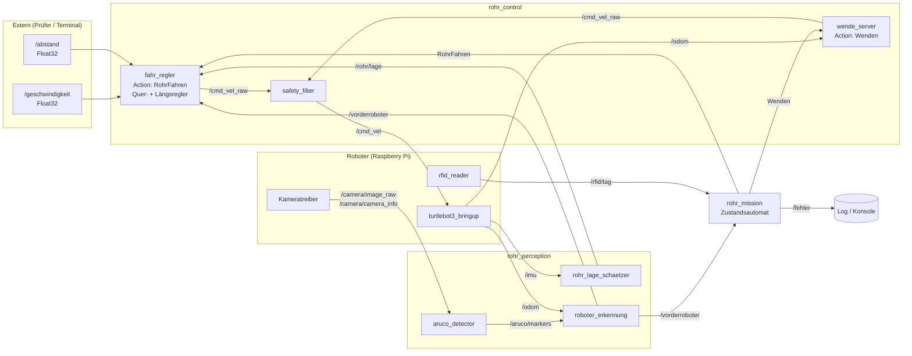
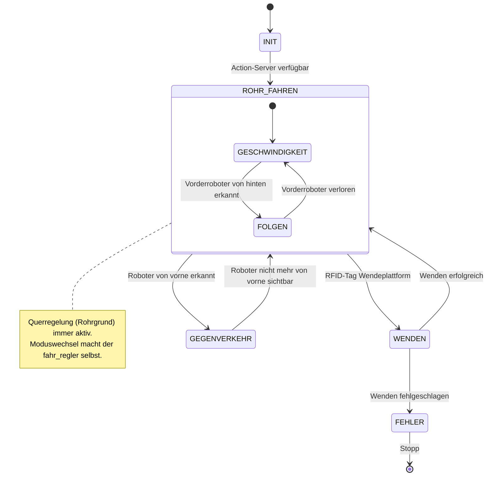
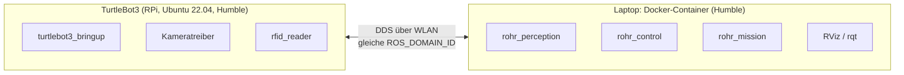

# Software-Architektur – TurtleBot3: Fahren im Rohr & Folgemanöver

> Grober Entwurf (Stand: 11.11.2026). Plattform: TurtleBot3, ROS 2 Humble, Entwicklung im Docker-Devcontainer.
>
> Das System besteht aus zwei Teilaufgaben, die am Ende zu **einem** System integriert werden:
> - **1.3.2 Fahren im Rohr** – auf dem Rohrgrund fahren, Abweichung ausregeln, an den Enden (RFID) wenden
> - **1.3.3 Folgemanöver** – Roboter per ArUco erkennen, Abstand berechnen, mit Soll-Abstand folgen

---

## 1. Anforderungen

Jede Anforderung bekommt eine ID. Damit lässt sich in Code, Tests und Pull Requests darauf verweisen
(z.B. Commit „R-FOLGE-6: Begrenzung Soll-Abstand“). Die Zuordnung zu den Komponenten steht in [Kapitel 7](#7-rückverfolgbarkeit-anforderung--komponente--test).

### 1.1 Fahren im Rohr (Aufgabe 1.3.2)

| ID | Anforderung |
|---|---|
| R-ROHR-1 | Der Roboter abonniert ein Topic **Geschwindigkeit** (`std_msgs/Float32`). Der zuletzt empfangene Wert wird gespeichert. |
| R-ROHR-2 | Im Rohr fährt der Roboter mit der zuletzt empfangenen Geschwindigkeit. Wurde noch keine empfangen, gilt **0 m/s**. |
| R-ROHR-3 | Soll-Geschwindigkeiten außerhalb von **[0, 0.2] m/s** werden auf dieses Intervall begrenzt. |
| R-ROHR-4 | Der Roboter fährt auf dem **Grund des Rohrs**. Eine erkannte Abweichung wird ausgeregelt. |
| R-ROHR-5 | Die Lage im Rohr kann mit der **Kamera und/oder dem Beschleunigungssensor** erkannt werden. |
| R-ROHR-6 | An den Enden des Rohres **wendet** der Roboter. |
| R-ROHR-7 | Die Wendeplattform kann über einen **RFID-Tag** erkannt werden. |

### 1.2 Folgemanöver (Aufgabe 1.3.3, baut auf 1.3.2 auf)

| ID | Anforderung |
|---|---|
| R-FOLGE-1 | Der Roboter erkennt **vorausfahrende oder stehende** Roboter. Bei stehenden Robotern wird erkannt, ob man sie **von hinten oder von vorne** sieht. Von vorne → **Fehlermeldung**. |
| R-FOLGE-2 | Der Roboter berechnet den **Abstand** zu einem vorausfahrenden oder stehenden Roboter. |
| R-FOLGE-3 | Erkennung und Abstand können über die **Kamera und ArUco-Marker** auf den Robotern erfolgen. |
| R-FOLGE-4 | Der Roboter abonniert ein Topic **Abstand** (`std_msgs/Float32`). Der zuletzt empfangene Wert wird gespeichert. |
| R-FOLGE-5 | Wird ein vorausfahrender Roboter erkannt, folgt der Roboter ihm mit dem zuletzt empfangenen Soll-Abstand. Wurde noch keiner empfangen, gilt **0.5 m**. |
| R-FOLGE-6 | Soll-Abstände außerhalb von **[0.2, 1.0] m** werden auf dieses Intervall begrenzt. |

### 1.3 Abgeleitete (eigene) Anforderungen

Diese Punkte stehen nicht in der Aufgabe, sind für ein robustes Gesamtsystem aber sinnvoll:

| ID | Anforderung |
|---|---|
| R-SYS-1 | Beide Teilfunktionen laufen gleichzeitig: Im Rohr wird **immer** quer geregelt; längs wird je nach Lage entweder die Soll-Geschwindigkeit gefahren oder gefolgt. |
| R-SYS-2 | Ungültige Werte auf `Geschwindigkeit`/`Abstand` (NaN, ±inf) werden verworfen; der letzte gültige Wert bleibt erhalten. |
| R-SYS-3 | Kommt längere Zeit (~0.5 s) kein Fahrbefehl, bleibt der Roboter stehen (Watchdog). |
| R-SYS-4 | Wird ein Roboter von vorne gesehen, hält der eigene Roboter zusätzlich zur Fehlermeldung an (Kollisionsgefahr im Rohr). |
| R-SYS-5 | Nach dem Wenden wird derselbe RFID-Tag ignoriert, bis der Roboter die Plattform verlassen hat. Sonst wendet er sofort erneut. |

---

## 2. Überblick

Die Software ist in **vier Schichten** aufgeteilt. Die Schichten sprechen nur über ROS-Topics und -Actions
miteinander, deshalb können drei Personen parallel daran arbeiten.

| Schicht | Aufgabe | ROS-Pakete |
|---|---|---|
| **Ablaufsteuerung** | Entscheidet, *was* der Roboter gerade tut: im Rohr fahren, wenden oder im Fehlerzustand stehen | `rohr_mission` |
| **Regelung** | Entscheidet, *wie* gefahren wird: Querregler, Längsregler (Geschwindigkeit oder Folgen), Wenden | `rohr_control` |
| **Wahrnehmung** | Macht aus Rohdaten verwertbare Größen: Rollwinkel im Rohr, ArUco-Marker, Vorderroboter, RFID | `rohr_perception` |
| **Hardware / Treiber** | TurtleBot3-Bringup (IMU, Odometrie, Motoren), Kamera, RFID-Leser | `turtlebot3_bringup`, Kameratreiber, `rfid_reader` |

Querschnitt: `rohr_interfaces` (eigene Msgs/Actions) und `rohr_bringup` (Launch-Dateien, Parameter, Simulation).

### Grundidee: Quer- und Längsregelung trennen

Die beiden Teilaufgaben lassen sich sauber auf zwei unabhängige Regler aufteilen:

- **Querregelung → Drehrate ω** (aus Aufgabe 1.3.2): hält den Roboter auf dem Rohrgrund.
- **Längsregelung → Geschwindigkeit v** (aus 1.3.2 + 1.3.3): fährt im Modus *GESCHWINDIGKEIT*
  die Soll-Geschwindigkeit. Sobald ein Vorderroboter erkannt wird, wechselt sie automatisch in den
  Modus *FOLGEN* und hält den Soll-Abstand.

Beide Regler laufen im selben Knoten (`fahr_regler`) und ergeben zusammen einen `Twist`.
Für die Integration der Teilaufgaben muss deshalb nur die Längsregelung um den Folgemodus erweitert werden.

### Knoten-Graph



**Grundregel:** Nur der `safety_filter` publiziert auf `/cmd_vel`. Alle Regler schreiben auf
`/cmd_vel_raw`, und es ist immer nur **ein** Regler aktiv, nämlich der, dessen Action gerade läuft.

---

## 3. Pakete und Ordnerstruktur

```
ros2_turtlebot_project/
├── Dockerfile
├── .devcontainer/
├── docs/
│   └── ARCHITEKTUR.md
└── src/
    ├── rohr_interfaces/          # ament_cmake – nur .msg / .action
    │   ├── msg/
    │   │   ├── RohrLage.msg
    │   │   ├── ArucoMarker.msg
    │   │   ├── ArucoMarkerArray.msg
    │   │   └── VorderRoboter.msg
    │   └── action/
    │       ├── RohrFahren.action
    │       └── Wenden.action
    │
    ├── rohr_perception/          # ament_python
    │   └── rohr_perception/
    │       ├── rohr_lage_node.py         # ROS-Hülle: /imu → /rohr/lage
    │       ├── rohr_lage.py              # reine Logik: Rollwinkel, Filter, Offset
    │       ├── aruco_detector_node.py    # ROS-Hülle: Bild → Marker-Posen
    │       ├── aruco_logik.py            # reine OpenCV-Logik
    │       ├── roboter_erkennung_node.py # ROS-Hülle: Marker → /vorderroboter
    │       └── roboter_erkennung.py      # reine Logik: vorne/hinten, steht/fährt, Abstand
    │
    ├── rohr_control/             # ament_python
    │   └── rohr_control/
    │       ├── fahr_regler_node.py       # ROS-Hülle, Action-Server RohrFahren
    │       ├── querregler.py             # reiner Regler (PD auf Rollwinkel)
    │       ├── laengsregler.py           # reiner Regler (Geschwindigkeit / Folgen)
    │       ├── sollwerte.py              # Begrenzung + Default-Werte (R-ROHR-3, R-FOLGE-6)
    │       ├── wende_server.py           # Action-Server Wenden
    │       ├── bahnberechnung.py         # bestehende Bahnberechnung (für das Wenden nutzbar)
    │       └── safety_filter.py
    │
    ├── rohr_hardware/            # ament_python – läuft nur auf dem Roboter
    │   └── rohr_hardware/
    │       └── rfid_reader_node.py       # RFID-Leser → /rfid/tag
    │
    ├── rohr_mission/             # ament_python
    │   └── rohr_mission/
    │       └── mission_node.py           # Zustandsautomat, Action-Clients
    │
    └── rohr_bringup/             # ament_python (nur Daten)
        ├── launch/
        │   ├── robot.launch.py           # läuft auf dem TurtleBot
        │   ├── laptop.launch.py          # läuft im Container auf dem Laptop
        │   └── sim.launch.py             # Gazebo + alle eigenen Knoten
        ├── config/
        │   ├── regler.yaml               # Verstärkungen Quer-/Längsregler
        │   ├── aruco.yaml                # Dictionary, Markergröße, ID → (Roboter, Seite)
        │   ├── rfid.yaml                 # bekannte Tags der Wendeplattformen
        │   └── camera_calibration.yaml
        ├── rviz/rohr.rviz
        └── worlds/rohr.world             # Gazebo-Rohr (optional, siehe Kap. 6)
```

**Designprinzip „ROS-Hülle + reine Logik“:** Wie bei der bestehenden `Bahnberechnung` steckt die
eigentliche Logik (Regler, Begrenzung, Marker-Auswertung) in Klassen **ohne ROS-Abhängigkeit**.
Der ROS-Knoten ist nur eine dünne Hülle (Subscriber → Logik → Publisher).
Vorteil: Die meisten Anforderungen (z.B. Begrenzung und Default-Werte) lassen sich mit `pytest`
testen, ohne Roboter und ohne Simulation.

---

## 4. Schnittstellen (`rohr_interfaces`)

Diese Schnittstellen sollten **als Erstes** gemeinsam festgelegt und gemergt werden.
Danach kann jeder an seinem Paket arbeiten.

### 4.1 Vorgegebene Topics (aus der Aufgabe)

| Topic | Typ | Bedeutung | Default | Begrenzung |
|---|---|---|---|---|
| `/geschwindigkeit` | `std_msgs/Float32` | Soll-Geschwindigkeit im Rohr [m/s] | 0.0 | [0, 0.2] |
| `/abstand` | `std_msgs/Float32` | Soll-Abstand zum Vorderroboter [m] | 0.5 | [0.2, 1.0] |

Die genauen Topic-Namen (Groß-/Kleinschreibung, Namespace) beim Betreuer erfragen. Im Code
die Namen nicht fest verdrahten, sondern per Remapping in der Launch-Datei anpassbar halten.

Test von Hand:
```bash
ros2 topic pub --once /geschwindigkeit std_msgs/msg/Float32 "{data: 0.15}"
```

### 4.2 Eigene Messages

```text
# RohrLage.msg  – Lage des Roboters im Rohr
std_msgs/Header header
float32 rollwinkel        # phi [rad], 0 = auf dem Rohrgrund, Vorzeichen siehe Kap. 5.1
float32 rollrate          # dphi/dt [rad/s]
float32 querablage        # ≈ R_rohr * phi [m] (nur zur Anzeige / Debug)
bool    gueltig

# ArucoMarker.msg
int32 id
geometry_msgs/Pose pose   # Pose des Markers im Kamera-Frame (optical frame)

# ArucoMarkerArray.msg
std_msgs/Header header
ArucoMarker[] markers

# VorderRoboter.msg  – Ergebnis der Roboter-Erkennung
std_msgs/Header header
uint8 SEITE_HINTEN=0
uint8 SEITE_VORNE=1
bool    erkannt
int32   marker_id
uint8   seite             # HINTEN = wir sehen sein Heck, VORNE = wir sehen seine Front
float32 abstand           # [m], Definition siehe Kap. 5.4
bool    steht             # geschätzte Eigengeschwindigkeit des anderen ≈ 0
float32 geschwindigkeit   # geschätzte Geschwindigkeit des anderen Roboters [m/s]
```

### 4.3 Actions

```text
# RohrFahren.action – läuft, bis die Mission sie abbricht (z.B. RFID erkannt)
---
bool success
---
uint8 MODUS_GESCHWINDIGKEIT=0
uint8 MODUS_FOLGEN=1
uint8   modus
float32 v_ist
float32 rollwinkel
float32 abstand_vorne     # -1 wenn kein Vorderroboter

# Wenden.action
float32 winkel            # [rad], Standard pi
---
bool success
---
float32 restwinkel
```

### 4.4 Topics (Übersicht)

| Topic | Typ | Publisher | Subscriber |
|---|---|---|---|
| `/imu` | `sensor_msgs/Imu` | turtlebot3_bringup | rohr_lage_schaetzer |
| `/odom` | `nav_msgs/Odometry` | turtlebot3_bringup | roboter_erkennung, wende_server |
| `/camera/image_raw` (bzw. `/compressed`) | `sensor_msgs/Image` | Kameratreiber | aruco_detector |
| `/camera/camera_info` | `sensor_msgs/CameraInfo` | Kameratreiber | aruco_detector |
| `/geschwindigkeit` | `std_msgs/Float32` | extern | fahr_regler |
| `/abstand` | `std_msgs/Float32` | extern | fahr_regler |
| `/rohr/lage` | `rohr_interfaces/RohrLage` | rohr_lage_schaetzer | fahr_regler |
| `/aruco/markers` | `rohr_interfaces/ArucoMarkerArray` | aruco_detector | roboter_erkennung |
| `/aruco/debug_image` | `sensor_msgs/Image` | aruco_detector | RViz / rqt (Debug) |
| `/vorderroboter` | `rohr_interfaces/VorderRoboter` | roboter_erkennung | fahr_regler, mission |
| `/rfid/tag` | `std_msgs/String` (Tag-UID) | rfid_reader | mission |
| `/mission/zustand` | `std_msgs/String` | mission | Debug |
| `/fehler` | `std_msgs/String` | mission | Konsole / Log |
| `/cmd_vel_raw` | `geometry_msgs/Twist` | fahr_regler, wende_server | safety_filter |
| `/cmd_vel` | `geometry_msgs/Twist` | safety_filter | turtlebot3_bringup |

### 4.5 TF-Baum

```
odom ──> base_footprint ──> base_link ──┬──> imu_link
                                         ├──> base_scan
                                         └──> camera_link ──> camera_rgb_optical_frame
```

---

## 5. Komponenten im Detail

### 5.1 `rohr_lage_schaetzer` – Lage im Rohr (R-ROHR-4, R-ROHR-5)

**Idee:** Fährt der Roboter nicht auf dem Rohrgrund, sondern seitlich an der Rohrwand hoch, kippt er
um seine Längsachse. Der **Rollwinkel φ** ist damit direkt ein Maß für die seitliche Abweichung
(Querablage ≈ R_Rohr · φ). Der Beschleunigungssensor misst die Schwerkraft und liefert φ ohne Kamera.

- Quelle: `/imu` vom OpenCR-Board des TurtleBot3 (`sensor_msgs/Imu`)
- Rollwinkel aus der Beschleunigung: `φ = atan2(a_y, a_z)`
- Beschleunigungswerte sind beim Fahren verrauscht → **Tiefpass** oder **Komplementärfilter**
  mit dem Gyroskop (`angular_velocity.x`):
  `φ = α·(φ + ω_x·Δt) + (1−α)·φ_acc`, mit α ≈ 0.95–0.98
- Alternativ die bereits fusionierte `orientation` (Quaternion) aus `/imu` verwenden und mit den
  Rohwerten vergleichen
- **Offset kalibrieren:** Die IMU ist nicht perfekt waagrecht eingebaut, deshalb im Stand auf
  ebenem Boden den Mittelwert von φ als Nullpunkt speichern (Parameter oder Service)
- Kamera (R-ROHR-5 erlaubt beides) als optionale Ausbaustufe, z.B. Erkennung der Rohrkrümmung im
  Bild. Für den Anfang reicht die IMU.

### 5.2 `fahr_regler` – Quer- und Längsregelung (R-ROHR-1…4, R-FOLGE-4…6)

Action-Server `RohrFahren`. Läuft mit fester Rate (z.B. 20 Hz, Timer) und hält die zuletzt
empfangenen Sollwerte.

**Sollwert-Verwaltung (`sollwerte.py`):**
```python
v_soll = 0.0          # R-ROHR-2: Default
d_soll = 0.5          # R-FOLGE-5: Default

def on_geschwindigkeit(msg):              # R-ROHR-1
    if math.isfinite(msg.data):           # R-SYS-2
        v_soll = clamp(msg.data, 0.0, 0.2)   # R-ROHR-3

def on_abstand(msg):                      # R-FOLGE-4
    if math.isfinite(msg.data):
        d_soll = clamp(msg.data, 0.2, 1.0)   # R-FOLGE-6
```

**Querregler (`querregler.py`) → ω:** PD-Regler auf den Rollwinkel
```
ω = −K_p · φ − K_d · φ̇        (begrenzt auf ±ω_max)
```
- Der D-Anteil wirkt wie eine Rückführung der Ausrichtung zur Rohrachse, denn ein schräg
  fahrender Roboter klettert die Wand hoch: φ̇ ≈ v·sin(ψ)/R. Ohne D-Anteil schwingt der Roboter.
- Die **Vorzeichen** am echten Roboter prüfen: Fährt er nach links die Wand hoch, muss ω ihn
  nach rechts lenken.
- Bei v = 0 kann ein Differentialantrieb die Querablage nicht korrigieren, deshalb ω = 0 setzen,
  wenn der Roboter steht.

**Längsregler (`laengsregler.py`) → v:**

| Modus | Bedingung | Geschwindigkeit |
|---|---|---|
| GESCHWINDIGKEIT | kein Vorderroboter (`erkannt == false`) | `v = v_soll` |
| FOLGEN | Vorderroboter von hinten erkannt | `v = v_vorne + K_a · (d_ist − d_soll)` |
| STOPP | Roboter von vorne erkannt (R-SYS-4) | `v = 0` |

Danach gilt immer: `v = clamp(v, 0, 0.2)` (rückwärts fahren ist nicht vorgesehen).
- `v_vorne` (geschätzte Geschwindigkeit des Vorderroboters) dient als Vorsteuerung. Ohne sie
  folgt der Roboter mit bleibendem Abstandsfehler.
- Ein **stehender** Roboter von hinten ist nur ein Sonderfall von FOLGEN mit `v_vorne = 0`:
  Der Roboter hält bei `d_soll` dahinter an.
- Offener Punkt: Darf der Roboter beim Folgen schneller als `v_soll` fahren? Vorschlag:
  `v = min(v_soll, v_folge)` wie bei einem Abstandstempomat. Mit dem Betreuer klären,
  siehe Kap. 9.
- Hysterese beim Moduswechsel (z.B. Vorderroboter muss für N Bilder erkannt bzw. verloren sein),
  sonst flackert der Modus bei einzelnen Fehlerkennungen.

### 5.3 `aruco_detector` (R-FOLGE-3)

- Abonniert Kamerabild und `camera_info`, wandelt das Bild mit `cv_bridge` in ein OpenCV-Bild.
- Erkennt die Marker (`cv2.aruco`), schätzt mit Markergröße und Kalibrierung die Pose
  (`estimatePoseSingleMarkers` / `solvePnP`) und publiziert ein `ArucoMarkerArray`.
- Publiziert ein Debug-Bild mit eingezeichneten Markern und Achsen.
- **Voraussetzung:** Kamera kalibrieren (`ros2 run camera_calibration cameracalibrator ...`),
  sonst stimmt der Abstand nicht.
- **Achtung OpenCV-Version:** Ubuntu 22.04 / Humble bringt OpenCV 4.5.4 mit, also die *alte*
  ArUco-API (`cv2.aruco.Dictionary_get`, `DetectorParameters_create`, `detectMarkers`).
  Tutorials für OpenCV ≥ 4.7 (`cv2.aruco.ArucoDetector`) funktionieren dort nicht. Kein
  `opencv-contrib-python` per pip daneben installieren, das gibt Konflikte mit `cv_bridge`.

### 5.4 `roboter_erkennung` (R-FOLGE-1, R-FOLGE-2)

Wertet die Marker aus und macht daraus *einen* Vorderroboter:

- **Vorne oder hinten:** Beide Marker zeigen zur Kamera, die Lage des Markers allein reicht also
  nicht. Unterschieden wird über die **Marker-ID**. In `aruco.yaml` ist hinterlegt, welche ID
  an welchem Roboter vorne bzw. hinten klebt:
  ```yaml
  roboter_marker:
    10: {roboter: tb3_a, seite: hinten}
    11: {roboter: tb3_a, seite: vorne}
    20: {roboter: tb3_b, seite: hinten}
    21: {roboter: tb3_b, seite: vorne}
  ```
- **Abstand:** z-Komponente (Tiefe) bzw. Betrag des Translationsvektors im Kamera-Frame, minus
  die Versätze Kamera → eigene Front und Marker → Heck des anderen. Welcher Abstand genau gemeint
  ist (Kamera–Marker oder Stoßstange–Stoßstange), klären (Kap. 9).
- **Steht oder fährt:** Geschwindigkeit des anderen = eigene Geschwindigkeit (`/odom`) + zeitliche
  Änderung des Abstands (gefiltert). Unter einem Schwellwert (z.B. 0.02 m/s) gilt er als stehend.
- Mehrere Marker gleichzeitig sichtbar: den **nächsten** Roboter vor sich verwenden.
- Ist kein Marker für eine Zeit X sichtbar → `erkannt = false`.

### 5.5 `rfid_reader` (R-ROHR-7)

- Läuft auf dem Roboter und liest den RFID-Leser aus (z.B. RC522 über SPI am Raspberry Pi oder
  ein USB-Leser; hängt von der Hardware im Labor ab).
- Publiziert die UID jedes erkannten Tags auf `/rfid/tag`.
- `rfid.yaml` enthält die bekannten UIDs der Wendeplattformen. Fremde Tags werden ignoriert.

### 5.6 `wende_server` (R-ROHR-6)

Action-Server `Wenden`: dreht den Roboter auf der Stelle um `winkel` (Standard π), geregelt über
den Gierwinkel aus `/odom` (oder `/imu`).
Hier lässt sich die bestehende **`Bahnberechnung` wiederverwenden**: Mit Zielposition = aktuelle
Position und `ziel_theta = theta_aktuell + π` überspringt sie Phase 1 und führt nur die Drehung
(Phase 2) mit Winkel-Normalisierung und Toleranz aus.

### 5.7 `safety_filter`

- Leitet `/cmd_vel_raw` an `/cmd_vel` weiter.
- Begrenzt v auf [0, 0.2] m/s und ω auf ±ω_max, als zweite Absicherung zu R-ROHR-3.
- **Watchdog (R-SYS-3):** Kommt länger als ~0.5 s kein Befehl, hält er den Roboter an
  (z.B. wenn ein Knoten abstürzt oder das WLAN abreißt).

### 5.8 `mission` – Ablaufsteuerung (Integration beider Teilaufgaben)

Einfacher Zustandsautomat (Python-Enum + Timer mit 10 Hz). Action-Clients **asynchron**
aufrufen (`send_goal_async` + Callbacks) und in Callbacks nie blockierend warten.



- **ROHR_FAHREN:** `RohrFahren` läuft. Zwischen Geschwindigkeit und Folgen schaltet der
  `fahr_regler` selbst um, die Mission muss dafür nichts tun.
- **WENDEN:** `RohrFahren` abbrechen → `Wenden` senden → danach wieder `RohrFahren`.
  Den zuletzt gewendeten Tag sperren, bis ein anderer Tag erkannt oder eine Mindeststrecke
  gefahren wurde (R-SYS-5).
- **GEGENVERKEHR (R-FOLGE-1, R-SYS-4):** Fehlermeldung über `get_logger().error(...)` und auf
  `/fehler`, Roboter steht. Ist der Roboter nicht mehr von vorne sichtbar, geht es weiter.
- Den Zustand auf `/mission/zustand` publizieren, das hilft beim Debuggen.

---

## 6. Verteilung, Netzwerk und Simulation



- **Start:** Treiber und RFID auf dem Roboter, alles Eigene im Container. So ist es einfacher zu
  debuggen und zu ändern. Der Container läuft bereits mit `--net=host` ✔.
- **Mehrere Roboter im Labor:** Beim Folgemanöver fahren mehrere TurtleBots gleichzeitig. Jedes Team
  braucht eine **eigene `ROS_DOMAIN_ID`** (in `devcontainer.json` → `containerEnv` und auf dem
  Roboter in `~/.bashrc`). Sonst fährt euer Roboter mit dem `/cmd_vel` eines anderen Teams.
  Die Roboter erkennen sich nur optisch über ArUco, sie müssen also nicht miteinander kommunizieren.
- Kamerabilder sind für das WLAN groß, deshalb `image_transport` *compressed* nutzen
  (`ros-humble-image-transport-plugins` installieren). Wird das WLAN trotzdem zum Problem, läuft
  `aruco_detector` direkt auf dem Roboter. An der Architektur ändert sich dabei nichts, nur die
  Launch-Datei.
- Querregler bei Latenzproblemen ebenfalls auf den Roboter verlagern, denn `/imu` kommt mit hoher Rate.

**Simulation (optional):** Ein Rohr in Gazebo braucht ein Mesh, z.B. ein hohles Zylinder-STL aus
Blender oder FreeCAD. Die IMU funktioniert in der Simulation, RFID nicht. Dafür einen `fake_rfid`-Knoten
schreiben, der beim Erreichen einer x-Position laut `/odom` eine UID publiziert. Für das Folgemanöver
einen zweiten TurtleBot mit Marker-Textur in die Welt setzen. Für die Kamera das Modell `waffle_pi`
verwenden. Viele Teile lassen sich aber auch ohne Simulation testen: Sollwerte, Regler und Erkennungslogik
mit `pytest`, die IMU direkt am Roboter, indem man ihn von Hand kippt.

---

## 7. Rückverfolgbarkeit: Anforderung → Komponente → Test

| Anforderung | Komponente | Nachweis |
|---|---|---|
| R-ROHR-1 | `fahr_regler` (Subscriber) | `ros2 topic pub` + Feedback der Action prüfen |
| R-ROHR-2 | `sollwerte.py` | Unit-Test: ohne Nachricht → v = 0 |
| R-ROHR-3 | `sollwerte.py`, `safety_filter` | Unit-Test: −1 → 0, 0.1 → 0.1, 5 → 0.2, NaN → ignoriert |
| R-ROHR-4 | `querregler.py`, `rohr_lage_schaetzer` | Unit-Test Regler; Fahrversuch mit seitlichem Start im Rohr |
| R-ROHR-5 | `rohr_lage_schaetzer` (IMU) | Roboter von Hand kippen → φ in `/rohr/lage` plausibel |
| R-ROHR-6 | `wende_server`, `mission` | Fahrversuch: Roboter dreht um 180° und fährt zurück ins Rohr |
| R-ROHR-7 | `rfid_reader`, `mission` | Tag an Leser halten → `/rfid/tag` zeigt die UID |
| R-FOLGE-1 | `roboter_erkennung`, `mission` | Unit-Test ID → Seite; Versuch: Roboter von vorne → Fehlermeldung |
| R-FOLGE-2 | `roboter_erkennung` | Marker in bekanntem Abstand (Maßband) → Abweichung < x cm |
| R-FOLGE-3 | `aruco_detector` | Debug-Bild zeigt Marker mit ID und Achsen |
| R-FOLGE-4 | `fahr_regler` (Subscriber) | `ros2 topic pub /abstand ...` |
| R-FOLGE-5 | `laengsregler.py`, `sollwerte.py` | Unit-Test Default 0.5; Versuch: Abstand zu fahrendem Roboter hält sich |
| R-FOLGE-6 | `sollwerte.py` | Unit-Test: 0.1 → 0.2, 0.7 → 0.7, 3 → 1.0 |

---

## 8. Team, Meilensteine, Zusammenarbeit

### Aufteilung (Vorschlag)

| Person | Schwerpunkt | Pakete / Aufgaben |
|---|---|---|
| A | Fahren im Rohr | `rohr_lage_schaetzer` (IMU, Filter), `querregler`, `sollwerte`, Tuning im Rohr |
| B | Folgemanöver | Kamera + Kalibrierung, `aruco_detector`, `roboter_erkennung`, `laengsregler` (Folgen) |
| C | Ablauf & Integration | `rohr_mission`, `rfid_reader`, `wende_server`, `safety_filter`, `rohr_bringup` (Launch) |

Gemeinsam zuerst: `rohr_interfaces` festlegen.

### Meilensteine

1. Interfaces und Paketgerüste stehen, alle Pakete bauen mit `colcon build`, Unit-Tests für `sollwerte.py` sind grün
2. IMU liefert plausiblen Rollwinkel; Roboter fährt mit `/geschwindigkeit` geradeaus im Rohr und regelt den Rollwinkel aus (**Teil 1.3.2 ohne Wenden**)
3. RFID wird erkannt, Roboter wendet an beiden Enden (**Teil 1.3.2 komplett**)
4. ArUco-Erkennung mit kalibrierter Kamera; Abstand und vorne/hinten stimmen (**Teil 1.3.3 Wahrnehmung**)
5. Folgen mit `/abstand` außerhalb des Rohrs, dann im Rohr (**Teil 1.3.3 komplett**)
6. Gesamtsystem: Rohrfahrt, Wenden, Folgen und Gegenverkehr zusammen testen

### Zusammenarbeit im GitHub-Repo

- `main` schützen, auf Feature-Branches arbeiten (`feature/querregler`, …) und per Pull Request mit
  Review durch eine zweite Person mergen.
- In Commits und PRs die Anforderungs-ID nennen (`R-ROHR-3: ...`).
- Änderungen an `rohr_interfaces` immer kurz absprechen, sie betreffen alle.
- `.gitignore` um `__pycache__/` und `*.pyc` ergänzen (aktuell sind `.pyc`-Dateien eingecheckt).
- Parameter (Reglerverstärkungen, Marker-IDs, RFID-UIDs) nur in YAML-Dateien ablegen, nicht im Code.
- Unit-Tests für die reinen Logik-Klassen (`pytest`) laufen mit `colcon test`.

---

## 9. Offene Punkte / mit dem Betreuer klären

- **Topic-Namen:** genau `Geschwindigkeit` / `Abstand` (Großschreibung?), mit oder ohne Namespace?
- **Hardware:** TurtleBot3-Modell (der Burger hat ab Werk keine Kamera), welche Kamera mit welchem
  Treiber (z.B. `v4l2_camera`), welcher RFID-Leser und wie ist er angeschlossen?
- **Rohr:** Durchmesser, Länge, Material. Passt der Roboter samt LiDAR/Kamera hinein? Ist es im
  Rohr hell genug für die Marker-Erkennung?
- **Wendeplattform:** Wendet der Roboter auf einer ebenen Plattform außerhalb des Rohrs? Wo genau
  liegt der Tag, und hat jedes Ende eine eigene UID?
- **ArUco:** Dictionary, Markergröße, Marker-IDs der Roboter. Sind vorne *und* hinten Marker angebracht?
- **Abstand:** zwischen welchen Punkten wird gemessen (Kamera–Marker oder Roboter–Roboter)?
- **Folgen vs. Soll-Geschwindigkeit:** Darf der Roboter beim Folgen schneller als `/geschwindigkeit`
  fahren, oder gilt `min(v_soll, v_folge)`?
- **Gegenverkehr:** Reicht eine Fehlermeldung, oder soll der Roboter auch anhalten bzw. wenden?
  Gilt das auch für einen *fahrenden* Roboter, der von vorne kommt?
