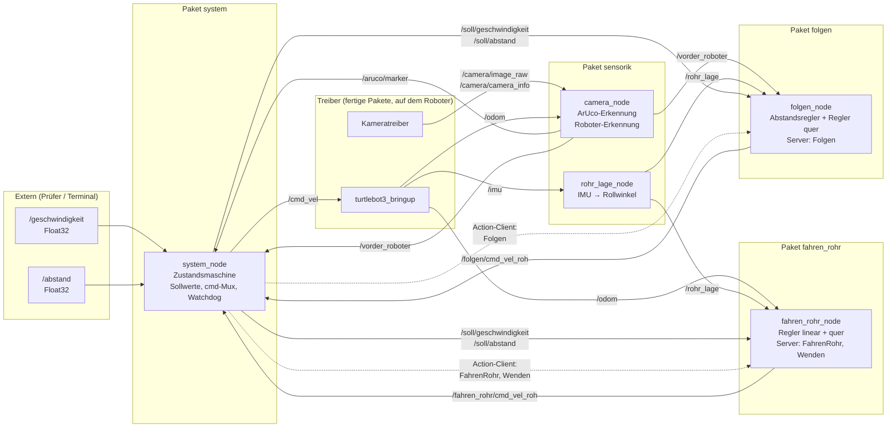
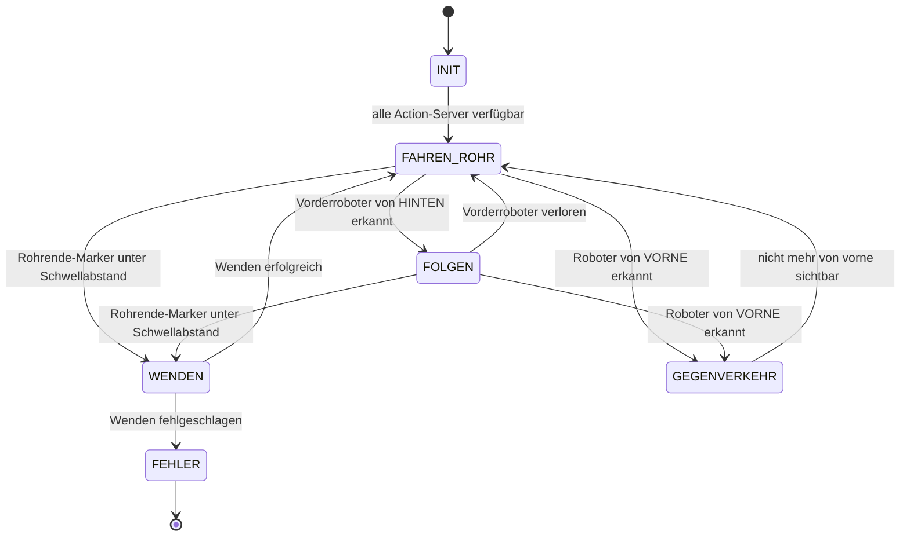

# Architektur Markdown wurde von KI erstellt und bildet momentan keine korrekte Architektur des Gesamten Systems dar!!
# Dient nur zur Orientierung


----------------------------------------------------------------------------------------------------------------------

# Software-Architektur – TurtleBot3: Fahren im Rohr & Folgemanöver
## 1. Anforderungen
### 1.1 Fahren im Rohr (Aufgabe 1.3.2)

| ID | Anforderung |
|---|---|
| R-ROHR-1 | Der Roboter abonniert ein Topic **Geschwindigkeit** (`std_msgs/Float32`). Der zuletzt empfangene Wert wird gespeichert. |
| R-ROHR-2 | Im Rohr fährt der Roboter mit der zuletzt empfangenen Geschwindigkeit. Wurde noch keine empfangen, gilt **0 m/s**. |
| R-ROHR-3 | Soll-Geschwindigkeiten außerhalb von **[0, 0.2] m/s** werden auf dieses Intervall begrenzt. |
| R-ROHR-4 | Der Roboter fährt auf dem **Grund des Rohrs**. Eine erkannte Abweichung wird ausgeregelt. |
| R-ROHR-5 | Die Lage im Rohr kann mit der **Kamera und/oder dem Beschleunigungssensor** erkannt werden. |
| R-ROHR-6 | An den Enden des Rohres **wendet** der Roboter. |
| R-ROHR-7 | Die Wendeplattform kann über einen **RFID-Tag** erkannt werden. → **Entfällt vorerst** (Absprache Team/Prof, RFID zu ungenau). Das Rohrende wird stattdessen über einen **ArUco-Marker** erkannt. |

### 1.2 Folgemanöver (Aufgabe 1.3.3, baut auf 1.3.2 auf)

| ID | Anforderung |
|---|---|
| R-FOLGE-1 | Der Roboter erkennt **vorausfahrende oder stehende** Roboter. Bei stehenden Robotern wird erkannt, ob man sie **von hinten oder von vorne** sieht. Von vorne → **Fehlermeldung**. |
| R-FOLGE-2 | Der Roboter berechnet den **Abstand** zu einem vorausfahrenden oder stehenden Roboter. |
| R-FOLGE-3 | Erkennung und Abstand können über die **Kamera und ArUco-Marker** auf den Robotern erfolgen. |
| R-FOLGE-4 | Der Roboter abonniert ein Topic **Abstand** (`std_msgs/Float32`). Der zuletzt empfangene Wert wird gespeichert. |
| R-FOLGE-5 | Wird ein vorausfahrender Roboter erkannt, folgt der Roboter ihm mit dem zuletzt empfangenen Soll-Abstand. Wurde noch keiner empfangen, gilt **0.5 m**. |
| R-FOLGE-6 | Soll-Abstände außerhalb von **[0.2, 1.0] m** werden auf dieses Intervall begrenzt. |

### 1.3 Abgeleitete (eigene) Anforderungen

| ID | Anforderung |
|---|---|
| R-SYS-1 | Auch beim Folgen im Rohr wird **quer geregelt**, der Roboter bleibt also auf dem Rohrgrund. |
| R-SYS-2 | Ungültige Werte auf `Geschwindigkeit`/`Abstand` (NaN, ±inf) werden verworfen; der letzte gültige Wert bleibt erhalten. |
| R-SYS-3 | Kommt längere Zeit (~0.5 s) kein Fahrbefehl vom aktiven Knoten, bleibt der Roboter stehen (Watchdog). |
| R-SYS-4 | Wird ein Roboter von vorne gesehen, hält der eigene Roboter zusätzlich zur Fehlermeldung an (Kollisionsgefahr im Rohr). |
| R-SYS-5 | Ein Rohrende-Marker löst das Wenden erst unterhalb eines Schwellabstands aus (z.B. 0.3 m). So löst der Marker am anderen Rohrende nicht schon aus der Ferne ein Wenden aus. |

---

## 2. Abgleich mit der Skizze

Die Grundstruktur der Skizze bleibt: eine Zustandsmaschine im `system_node` als einziger Publisher
auf `cmd_vel`, je ein Knoten für *Fahren im Rohr* und *Folgen*, die Sensorik in eigenen Knoten
und die Actions `wenden`, `fahren_rohr` und `folgen`. Folgende Punkte sind gegenüber der Skizze geändert:

| # | Skizze | Hier | Begründung |
|---|---|---|---|
| 1 | Msgs `Geschwindigkeit` und `Abstand` im `interface_package` | **`std_msgs/Float32`**, keine eigenen Msgs | Die Aufgabe schreibt den Typ Float32 Message vor (R-ROHR-1, R-FOLGE-4). Mit einer eigenen Msg kann der Prüfer nicht publizieren. |
| 2 | `system_node` abonniert Geschwindigkeit/Abstand, aber wie die Werte zu den Reglern kommen, ist offen | `system_node` prüft und begrenzt die Werte und gibt sie intern auf `/soll/geschwindigkeit` und `/soll/abstand` weiter | Begrenzung und Default-Werte gibt es dann nur an **einer** Stelle. Mit QoS *transient local* bekommen auch spät gestartete Knoten sofort den aktuellen Wert. |
| 3 | `camera_node` berechnet auch die `RohrLage` | eigener Knoten **`rohr_lage_node`** auf Basis der **IMU** (`/imu`) | Die Rohrlage kommt vom Beschleunigungssensor, nicht von der Kamera. Ein eigener Knoten läuft im IMU-Takt und bleibt nicht hängen, wenn die Bildverarbeitung langsam ist. Die Kamera kann später zusätzlich einfließen. |
| 4 | `fahren_im_rohr_node` und `folgen_node` abonnieren `ArUco` | `camera_node` publiziert alle gesehenen Marker auf **`/aruco/marker`**, abonniert vom `system_node`. Die Regler bekommen nur **`VorderRoboter`**. | Der `system_node` braucht die Marker für Zustandswechsel (z.B. Rohrende). Die Regler brauchen nur „Roboter ja/nein, Abstand, Seite“. |
| 5 | `folgen_node` abonniert `RohrLage`, Querregelung dort offen | `folgen_node` nutzt **dieselbe Querregler-Klasse** wie `fahren_rohr` (Import aus Paket `fahren_rohr`) | Beim Folgen im Rohr muss genauso auf dem Grund gefahren werden (R-SYS-1), aber der Regler soll nicht doppelt programmiert werden. |
| 6 | Paket `hardware` | Paket **`sensorik`** | Es enthält Auswertung (ArUco, Roboter, Rohrlage), keine Treiber. Die Treiber kommen von `turtlebot3_bringup` und dem Kameratreiber. |
| 7 | `folgen_rohr_node` (Paketliste) vs. `folgen_node` (Diagramm) | einheitlich **`folgen_node`** | Einheitliche Namen |
| 8 | Gestrichelte Linie `folgen` → `wenden_action` | Wenden ruft **nur der `system_node`** auf | Nach Fahren *und* nach Folgen wird gleich gewendet. Die Entscheidung dafür trifft die Zustandsmaschine. |
| 9 | Msg-Namen `rohr_lage`, `aruco_marker`, … | **`RohrLage.msg`, `ArucoMarker.msg`, …** | ROS 2 verlangt CamelCase für Msg- und Action-Dateien, sonst bricht `colcon build` ab. |
| 10 | `rfid_node`, RFID beendet `FahrenRohr`/`Folgen` | **kein RFID**. Das Rohrende erkennt der `system_node` über einen ArUco-Marker und bricht die laufende Action ab. | Absprache Team/Prof: RFID ist zu ungenau. Die Zustandswechsel liegen damit alle im `system_node`. |

---

## 3. Überblick

### Knoten-Graph



### Rollen der Knoten

| Knoten | Paket | Rolle |
|---|---|---|
| `system_node` | `system` | **Chef:** Zustandsmaschine, Sollwerte, entscheidet, welcher Regler fahren darf, einziger Publisher auf `/cmd_vel` |
| `fahren_rohr_node` | `fahren_rohr` | Fährt im Rohr mit Soll-Geschwindigkeit auf dem Rohrgrund; wendet |
| `folgen_node` | `folgen` | Folgt einem Vorderroboter mit Soll-Abstand, ebenfalls auf dem Rohrgrund |
| `camera_node` | `sensorik` | Bild → alle ArUco-Marker (`/aruco/marker`) und daraus `VorderRoboter` (Abstand, vorne/hinten, steht/fährt) |
| `rohr_lage_node` | `sensorik` | IMU → Rollwinkel im Rohr |

**Grundregeln:**
1. Nur der `system_node` publiziert auf `/cmd_vel`. Die Regler publizieren auf eigene
   `.../cmd_vel_roh`-Topics („cmd roh“ in der Skizze). Der `system_node` leitet nur das Topic
   des Knotens weiter, der im aktuellen Zustand aktiv ist (Multiplexer).
2. **Wann** etwas passiert, entscheidet der `system_node`. **Wie** gefahren wird, entscheiden die Regler-Knoten.
3. Jeder Knoten besteht aus einer **ROS-Hülle (`*_node.py`) und reiner Logik (`*_logik.py`) ohne ROS**,
   wie in der Skizze vorgesehen. Die Logik ist damit mit `pytest` ohne Roboter testbar.

---

## 4. Pakete und Ordnerstruktur

```
ros2_turtlebot_project/
├── Dockerfile
├── .devcontainer/
├── docs/ARCHITEKTUR.md
└── src/
    ├── interface_package/        # ament_cmake (wird neu angelegt)
    │   ├── msg/
    │   │   ├── RohrLage.msg
    │   │   ├── ArucoMarker.msg       # eine Message für alle N Marker
    │   │   └── VorderRoboter.msg
    │   └── action/
    │       ├── Wenden.action
    │       ├── FahrenRohr.action
    │       └── Folgen.action
    │
    ├── sensorik/                 # ament_python   (Skizze: „hardware“)
    │   └── sensorik/
    │       ├── camera_node.py
    │       ├── aruco_erkennung.py        # reine Logik (OpenCV)
    │       ├── roboter_erkennung.py      # reine Logik (ID → Seite, Abstand, steht/fährt)
    │       ├── rohr_lage.py              # reine Logik (Rollwinkel, Filter, Offset)
    │
    ├── fahren_rohr/              # ament_python
    │   └── fahren_rohr/
    │       ├── fahren_rohr_node.py       # Action-Server FahrenRohr + Wenden
    │       ├── fahren_rohr_logik.py
    │       ├── regler_linear.py          # Geschwindigkeit mit Rampe
    │       ├── regler_quer.py            # PD auf Rollwinkel – wird auch von folgen genutzt
    │       └── wenden_logik.py           # Drehung um 180° 
    │
    ├── folgen/                   # ament_python, <depend>fahren_rohr</depend>
    │   └── folgen/
    │       ├── folgen_node.py            # Action-Server Folgen
    │       └── folgen_logik.py           # Abstandsregler; importiert fahren_rohr.regler_quer
    │
    ├── system/                   # ament_python
    │   └── system/
    │       ├── system_node.py            # Action-Clients, Mux, Watchdog
    │       ├── system_logik.py           # Zustandsmaschine (reine Logik)
    │       └── sollwerte.py              # Begrenzung + Defaults (R-ROHR-3, R-FOLGE-6)

```

## 5. Schnittstellen (`interface_package`)

### 5.1 Vorgegebene Topics (aus der Aufgabe)

| Topic | Typ | Default | Begrenzung | Abonniert von |
|---|---|---|---|---|
| `/geschwindigkeit` | `std_msgs/Float32` | 0.0 m/s | [0, 0.2] | `system_node` |
| `/abstand` | `std_msgs/Float32` | 0.5 m | [0.2, 1.0] | `system_node` |

### 5.2 Messages

```text
# RohrLage.msg
std_msgs/Header header
float32 rollwinkel        # phi [rad], 0 = auf dem Rohrgrund
float32 rollrate          # dphi/dt [rad/s]
bool    gueltig

# ArucoMarker.msg – Zustand aller bekannten Marker in einem Kamerabild
# Index im Array = Marker-ID (0 … N-1). Alle Arrays haben fest die Länge N.
# Bedeutung der IDs (Platzhalter, an die echten Marker anpassen)
uint8 ROHRENDE_A=0
uint8 ROHRENDE_B=1
# ... weitere IDs bis N-1

std_msgs/Header header              # Zeitstempel des Bildes
bool[N]               sichtbar
float32[N]            abstand       # [m], inf wenn nicht sichtbar
geometry_msgs/Pose[N] pose          # Pose im Kamera-Frame, nur gültig wenn sichtbar

# VorderRoboter.msg
std_msgs/Header header
uint8 SEITE_HINTEN=0
uint8 SEITE_VORNE=1
bool    erkannt
int32   marker_id
uint8   seite             # HINTEN = wir sehen sein Heck, VORNE = seine Front
float32 abstand           # [m]
bool    steht
float32 geschwindigkeit   # geschätzte Geschwindigkeit des anderen [m/s]

```

#### ArucoMarker: eine Message für alle Marker

Die Aufgabe hat eine feste, bekannte Menge an Markern mit gleichbleibenden IDs. Deshalb gibt es
**eine** Message mit Arrays **fester Länge N**: Der Index im Array ist die Marker-ID. Jeder
Marker hat damit immer seinen festen Platz, egal ob er gerade sichtbar ist.

> **Noch offen:** Anzahl der Marker N und Bedeutung der IDs. Bis dahin stehen `N` und die
> Konstanten als Platzhalter. In der `.msg` muss N als **Zahl** stehen (z.B. `float32[5]`),
> eine Konstante ist dort nicht erlaubt.

**Regeln für alle, die die Message nutzen:**
1. **Marker-IDs 0 … N-1 verwenden.** Die Marker mit genau diesen IDs ausdrucken. Andere IDs
   bräuchten eine Umrechnungstabelle von ID zu Index.
2. **Immer zuerst `sichtbar` prüfen.** Auch nicht sichtbare Marker haben einen Eintrag. Damit der
   ROS-Default `abstand = 0.0` kein falsches Ereignis auslöst (z.B. „Rohrende < 0.3 m“), setzt der
   Publisher nicht sichtbare Marker auf `inf`.
3. **Jede ID hat nur einen Platz.** Tragen zwei Roboter denselben Marker, wird nur der nähere
   gemeldet. Müssen zwei Roboter mit gleicher ID gleichzeitig unterschieden werden, passt diese
   Message nicht mehr.
4. **Fremde IDs (≥ N) werden ignoriert**, z.B. Marker anderer Teams.
5. **Konstanten statt Zahlen verwenden:** `ArucoMarker.ROHRENDE_A` statt `0`, und `len(msg.sichtbar)`
   statt einer festen Länge im Python-Code.
6. **Ändert sich N, ändert sich die Schnittstelle.** Dann `[N]` in der `.msg` anpassen und alle
   Pakete neu bauen, die die Message nutzen, auf dem Laptop **und** auf dem Roboter. Passen die
   Definitionen auf beiden Seiten nicht zusammen, kommen die Nachrichten ohne klare Fehlermeldung
   nicht an.

### 5.3 Actions

`FahrenRohr` und `Folgen` laufen, bis der `system_node` sie abbricht (z.B. am Rohrende oder
beim Wechsel zwischen Fahren und Folgen). `Wenden` endet von selbst, sobald der Winkel erreicht ist.

```text
# FahrenRohr.action – im Rohr fahren, bis der system_node abbricht
---
bool  success
---
float32 v_ist
float32 rollwinkel
float32 gefahrene_strecke

# Folgen.action – dem Vorderroboter folgen, bis der system_node abbricht
---
bool  success
---
float32 abstand_ist
float32 abstand_soll
float32 v_ist

# Wenden.action
float32 winkel            # [rad], Standard pi
---
bool success
---
float32 restwinkel
```

### 5.4 Topics (Übersicht)

| Topic | Typ | Publisher | Subscriber |
|---|---|---|---|
| `/geschwindigkeit`, `/abstand` | `std_msgs/Float32` | extern | system_node |
| `/soll/geschwindigkeit`, `/soll/abstand` | `std_msgs/Float32` (transient local) | system_node | fahren_rohr_node, folgen_node |
| `/imu` | `sensor_msgs/Imu` | turtlebot3_bringup | rohr_lage_node |
| `/odom` | `nav_msgs/Odometry` | turtlebot3_bringup | camera_node, fahren_rohr_node |
| `/camera/image_raw` (bzw. `/compressed`), `/camera/camera_info` | `sensor_msgs/...` | Kameratreiber | camera_node |
| `/rohr_lage` | `interface_package/RohrLage` | rohr_lage_node | fahren_rohr_node, folgen_node |
| `/aruco/marker` | `interface_package/ArucoMarker` | camera_node | system_node |
| `/vorder_roboter` | `interface_package/VorderRoboter` | camera_node | system_node, folgen_node |
| `/aruco/debug_image` | `sensor_msgs/Image` | camera_node | rqt (Debug) |
| `/fahren_rohr/cmd_vel_roh` | `geometry_msgs/Twist` | fahren_rohr_node | system_node |
| `/folgen/cmd_vel_roh` | `geometry_msgs/Twist` | folgen_node | system_node |
| `/cmd_vel` | `geometry_msgs/Twist` | system_node | turtlebot3_bringup |
| `/system/zustand`, `/system/fehler` | `std_msgs/String` | system_node | Konsole / Debug |

-------------------------------------------------------------------------------------------------------

# Folgender Abschnitt wurde noch nicht überarbeitet !!!

## 6. Komponenten im Detail

### 6.1 `system_node` – Zustandsmaschine, Sollwerte, cmd-Mux

**Sollwerte (`sollwerte.py`), R-ROHR-1…3, R-FOLGE-4…6, R-SYS-2:**
```python
v_soll = 0.0          # R-ROHR-2: Default
d_soll = 0.5          # R-FOLGE-5: Default

def neue_geschwindigkeit(wert):          # R-ROHR-1
    if math.isfinite(wert):              # R-SYS-2
        v_soll = clamp(wert, 0.0, 0.2)   # R-ROHR-3

def neuer_abstand(wert):                 # R-FOLGE-4
    if math.isfinite(wert):
        d_soll = clamp(wert, 0.2, 1.0)   # R-FOLGE-6
```
Die Defaults werden beim Start einmal auf `/soll/...` publiziert, danach bei jeder Änderung.

**Zustandsmaschine (`system_logik.py`):**



| Zustand | aktive Action | Mux leitet weiter | Bemerkung |
|---|---|---|---|
| INIT | – | nichts (Stopp) | wartet auf Action-Server (`wait_for_server`) |
| FAHREN_ROHR | `FahrenRohr` | `/fahren_rohr/cmd_vel_roh` | |
| FOLGEN | `Folgen` | `/folgen/cmd_vel_roh` | Wechsel: `FahrenRohr` abbrechen, dann `Folgen` starten |
| WENDEN | `Wenden` | `/fahren_rohr/cmd_vel_roh` | Auslöser: Rohrende-ID in `/aruco/marker` unter dem Schwellabstand (R-SYS-5). Laufende Action abbrechen, dann `Wenden` starten. |
| GEGENVERKEHR | – | nichts (Stopp) | Fehlermeldung über `get_logger().error()` und `/system/fehler` (R-FOLGE-1, R-SYS-4) |
| FEHLER | – | nichts (Stopp) | |

- **Hysterese:** Der Vorderroboter muss z.B. 5 Bilder in Folge erkannt bzw. verloren sein, bevor
  der Zustand wechselt. Sonst springt das System bei Fehlerkennungen hin und her.
- Action-Clients **asynchron** aufrufen (`send_goal_async`, `cancel_goal_async` + Callbacks)
  und in Callbacks nie blockierend warten.
- **Mux + Watchdog (R-SYS-3):** Kommt vom aktiven Topic länger als 0.5 s nichts, wird ein
  Stopp-Befehl gesendet. Zusätzlich v auf [0, 0.2] und ω auf ±ω_max begrenzen.

### 6.2 `fahren_rohr_node` – Fahren im Rohr und Wenden

Zwei Action-Server in einem Knoten, deshalb `MultiThreadedExecutor` + Callback-Groups verwenden
(wie im bisherigen `SimpleMoverServer`).

**Regler linear (`regler_linear.py`):** fährt `v_soll` mit einer **Rampe** an
(z.B. 0.2 m/s²). Bei einem Sprung der Geschwindigkeit würde der Roboter sonst ruckeln und die Wand
hochrutschen.

**Regler quer (`regler_quer.py`), R-ROHR-4:** PD-Regler auf den Rollwinkel
```
ω = −K_p · φ − K_d · φ̇        (begrenzt auf ±ω_max)
```
- Fährt der Roboter seitlich die Rohrwand hoch, kippt er um die Längsachse (φ ≠ 0).
- Der D-Anteil dämpft, weil ein schräg fahrender Roboter die Wand hochklettert
  (φ̇ ≈ v·sin(ψ)/R). Ohne D-Anteil schwingt der Roboter.
- **Vorzeichen** am echten Roboter prüfen.
- Bei v ≈ 0 ist ω = 0, denn im Stand kann ein Differentialantrieb die Querablage nicht korrigieren.

**Wenden (`wenden_logik.py`), R-ROHR-6:** auf der Stelle um π drehen, geregelt über den Gierwinkel
aus `/odom`. Dafür kann die bestehende `Bahnberechnung` wiederverwendet werden: Zielposition =
aktuelle Position und `ziel_theta = theta + π`. Dann wird nur Phase 2 (Drehen) ausgeführt.

### 6.3 `folgen_node` – Folgemanöver (R-FOLGE-5)

**Abstandsregler (`folgen_logik.py`):**
```
v = v_vorne + K_a · (d_ist − d_soll)
v = clamp(min(v, v_soll), 0, 0.2)        # nicht schneller als im Rohr erlaubt (siehe Kap. 10)
ω = regler_quer(φ, φ̇)                    # gleiche Klasse wie in fahren_rohr (R-SYS-1)
```
- `v_vorne` (geschätzte Geschwindigkeit des Vorderroboters aus `VorderRoboter`) wirkt als
  Vorsteuerung. Ohne sie bleibt ein Abstandsfehler bestehen.
- Ein stehender Roboter von hinten ist nur der Sonderfall `v_vorne = 0`: Der Roboter hält bei
  `d_soll` dahinter an.
- Ist der Vorderroboter kurz nicht sichtbar, mit der letzten Messung weiterrechnen bzw. langsamer
  werden. Den Wechsel zurück zu `FahrenRohr` entscheidet der `system_node`.

### 6.4 `camera_node` – ArUco- und Roboter-Erkennung (R-FOLGE-1…3)

- Bild + `camera_info` → `cv_bridge` → `cv2.aruco` → Pose je Marker
  (`estimatePoseSingleMarkers` / `solvePnP`).
- Publiziert **bei jedem Bild** den Zustand aller N bekannten Marker als `ArucoMarker` auf
  `/aruco/marker`, auch wenn keiner sichtbar ist (siehe Kap. 5.2).
- Welche ID was bedeutet, steht als Konstanten in `ArucoMarker.msg`. So nutzen alle Knoten
  dieselben Namen.
- **Vorne/hinten über die Marker-ID:** Beide Marker zeigen zur Kamera, deshalb lässt sich die Seite
  nur über die ID unterscheiden. Die Zuordnung steht als Konstanten in `ArucoMarker.msg`
  (z.B. `ROBOTER_HINTEN`, `ROBOTER_VORNE`, IDs innerhalb 0 … N-1).
- **Abstand:** Tiefe (z) des Markers im Kamera-Frame, korrigiert um die Versätze zur eigenen Front und
  zum Heck des anderen Roboters.
- **Steht/fährt:** Geschwindigkeit des anderen = eigene Geschwindigkeit (`/odom`) + Änderung des
  Abstands über die Zeit (gefiltert). Liegt sie unter einem Schwellwert, gilt er als stehend.
- Mehrere Roboter sichtbar → den nächsten verwenden. Debug-Bild mit eingezeichneten Markern publizieren.
- **Voraussetzung:** Kamera kalibrieren (`ros2 run camera_calibration cameracalibrator ...`).
- **OpenCV in Humble ist 4.5.4**, also gilt die *alte* ArUco-API (`cv2.aruco.Dictionary_get`,
  `DetectorParameters_create`, `detectMarkers`). Tutorials mit `cv2.aruco.ArucoDetector` (≥ 4.7)
  funktionieren nicht. Kein `opencv-contrib-python` per pip nachinstallieren.

### 6.5 `rohr_lage_node` – Lage im Rohr (R-ROHR-5)

- Quelle: `/imu` vom OpenCR-Board.
- Rollwinkel aus der Beschleunigung: `φ_acc = atan2(a_y, a_z)`, verrauscht beim Fahren, deshalb
  **Komplementärfilter** mit dem Gyroskop: `φ = α·(φ + ω_x·Δt) + (1−α)·φ_acc`, mit α ≈ 0.95–0.98.
- **Nullpunkt kalibrieren:** im Stand auf ebenem Boden den Mittelwert als Offset speichern.
- Kamera-basierte Rohrerkennung (in der Skizze im `camera_node`) ist eine optionale Ausbaustufe und
  kann später hier mit einfließen.
